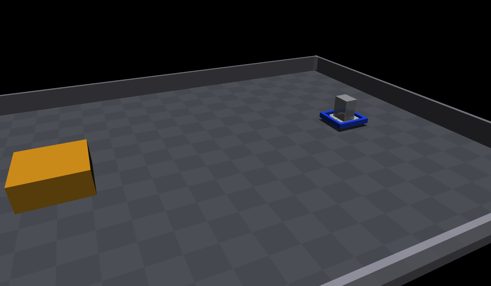
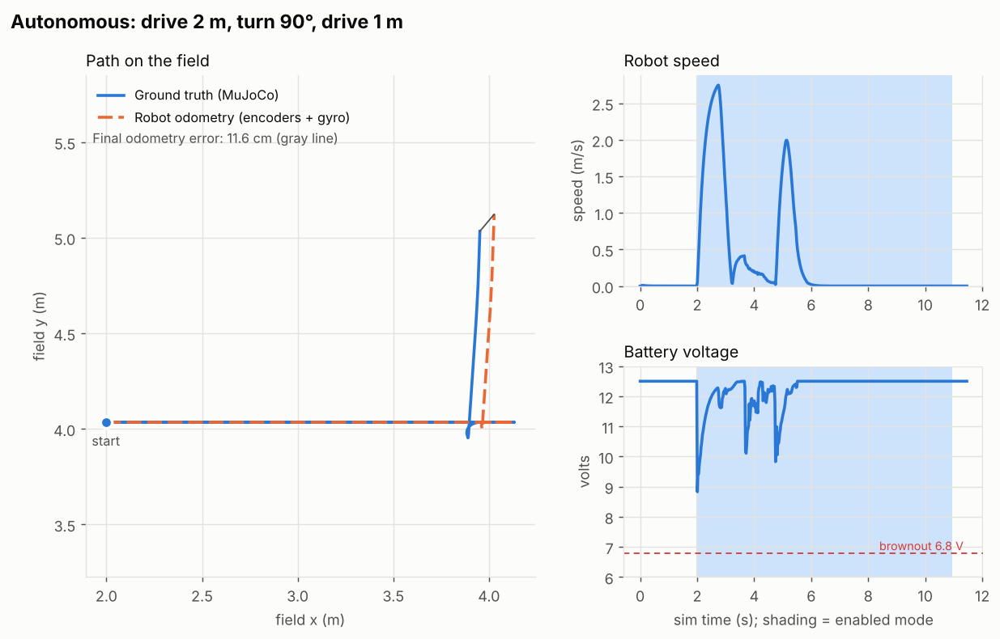
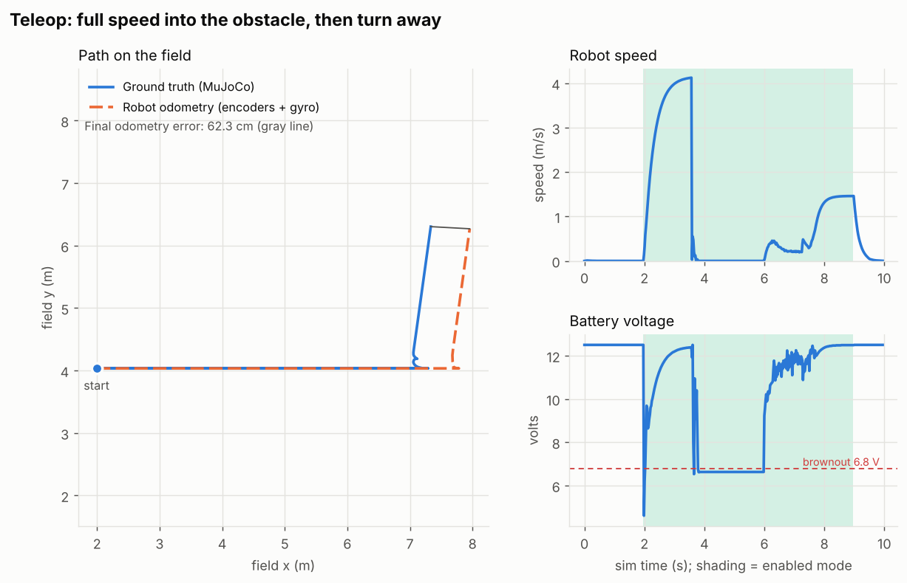
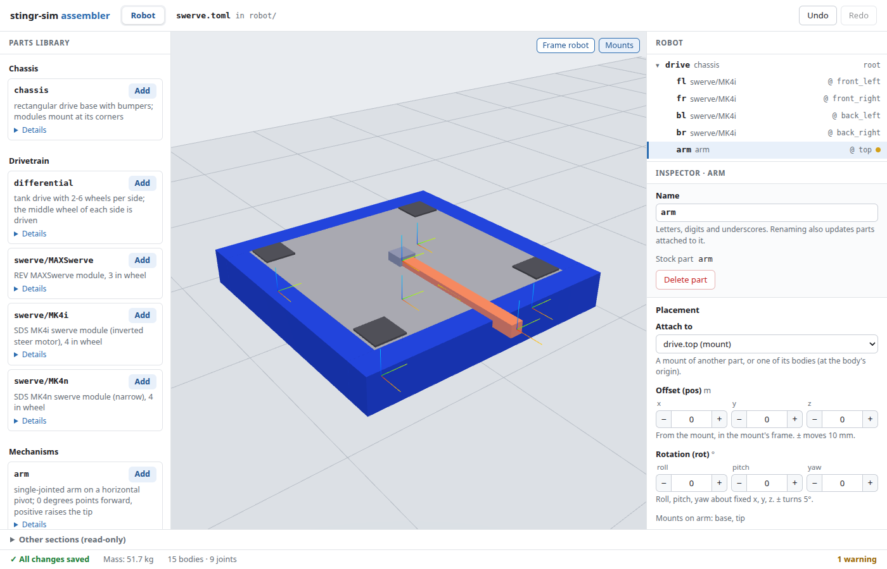
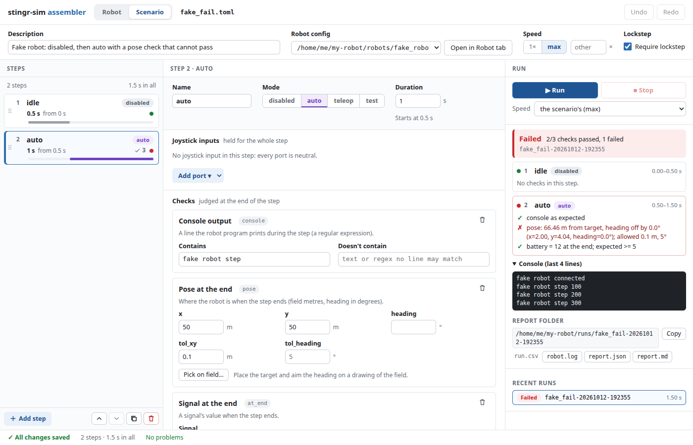
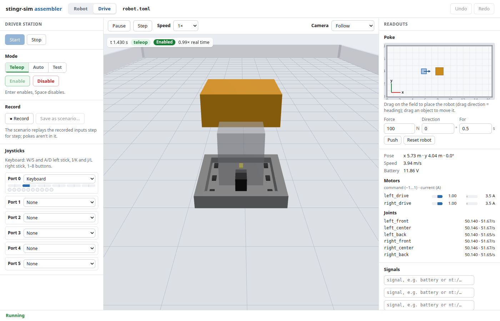
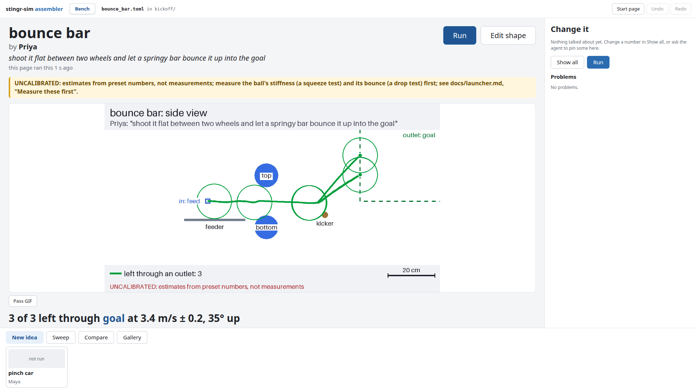

# Scrimmage — real WPILib robot code on a MuJoCo robot

`scrimmage` runs your robot program unmodified on a desktop and gives it a physical robot to control:
a MuJoCo rigid-body world with motors, wheels, gravity, friction, collisions and a sagging battery.

> **New here?** Start with [Getting started](docs/getting-started/README.md): short guides to installing it, trying
> a mechanism idea, running your robot code and testing it. This README is the full reference.

The robot program loads WPILib's standard **HALSim WebSocket client** (the same extension Synthesis
and the Romi/XRP use). Scrimmage is the server on the other end. It reads motor outputs, applies the
matching DC-motor torque to joints in the world, and sends back encoder counts, gyro angles, limit
switches, potentiometers and battery voltage. Java, C++ and Python robot projects all work, because
the protocol lives below WPILib.



```
 Robot program (Java / C++ / RobotPy, unmodified)
   └─ halsim_ws_client ── JSON over ws://localhost:3300/wpilibws ──┐
                                                                    ▼
 scrimmage bridge ── PWM speed / CANMotor % ──► DC-motor model ──► joint torque ──► MuJoCo (1 kHz)
                  ◄── Encoder counts, Gyro, AI, DIO, CANEncoder, battery V ◄── joint & body state
```

## Quick start

```bash
# needs Python 3.11 or newer (and MuJoCo 3.4 or newer, which pip installs)
python3 -m venv .venv && source .venv/bin/activate
pip install -e ".[robotpy,nt]"          # mujoco, websockets, plus RobotPy for the example
pip install ./lockstep                  # Linux: lets scrimmage drive the robot's clock
```

The lockstep extension (**Linux only** for now) is needed for `scrimmage run` by default and for agents:
the kitbot config's command loads it, and scenarios require it unless they set `require_lockstep = false`.
It is optional only for driving by hand in real time. To opt out:

- `scrimmage run`: set `require_lockstep = false` in the scenario. The run is then real time and
  `speed` has no effect.
- Agents and Sessions: drop `--scrimmage-lockstep` from the robot command (or don't install the extension).
  The session then runs in real time, isn't held between calls, and `advance` waits in real time.

(`serve --speed` other than 1 is the one command that exits with code 2 without the extension.) On
Windows and macOS the simulation always runs in real time this way.

Drive the robot by hand with two terminals, both started from the repo root:

```bash
# terminal 1: the physics world and 3D viewer (macOS: use `mjpython -m scrimmage serve ...`)
scrimmage serve configs/kitbot.toml --viewer

# terminal 2: the robot program (a fresh shell, so activate the venv again)
source .venv/bin/activate
cd examples/robotpy_kitbot
python -m robotpy sim --ws-client --scrimmage-lockstep   # drop --scrimmage-lockstep for real time without the extension
```

Terminal 2 opens the WPILib sim GUI. Enable Autonomous or Teleop there, and drag a controller onto
port 0. The example drives 2 m, turns 90° left and drives 1 m using only its encoders and gyro. In
teleop it arcade-drives from an Xbox controller on port 0.

`serve --launch` starts the `[robot_program]` command from the config for you and stops it when you
quit. In `configs/kitbot.toml` that command is headless (`--nogui`), so there is no Driver Station to
enable the robot: use `--launch` to watch or log a run, or with configs whose command opens its own GUI.
To drive by hand, use the two-terminal form above.

**Java/C++ projects:** Java robots with Phoenix 6 run through a Gradle init script; see
[Java robots (Phoenix 6)](#java-robots-phoenix-6). Without Phoenix, two lines in `build.gradle` are enough:
see [examples/java/README.md](examples/java/README.md).

`serve` options: `--launch`, `--viewer`, `--speed` (a real-time factor or `max`), `--step`, `--log FILE.csv`,
`--host`, `--port` (default 3300), `--sim-mode fast|phoenix` (see below), `--no-nt`, `--real-ds`/`--no-real-ds` (the
FRC Driver Station app drives the robot: [docs/driver-station.md](docs/driver-station.md)) and `-v`.

### Headless runs: scenario files

For CI or quick checks, describe a run in a scenario file and let Scrimmage play it:

```bash
scrimmage run scenarios/kitbot_auto.toml
```

It starts the robot program, plays each step (Driver Station mode, duration, joysticks), evaluates the
checks, takes the screenshots, and writes a report directory, `runs/<scenario>-<timestamp>/` by default
(change it with `--out DIR`). Files in it:

- `report.md`: a short readable summary with the screenshots inline
- `report.json`: the same results for scripts, with the measured and expected value of every check
- `*.png`: the screenshots and contact sheets
- `run.csv`: the ground-truth log (plot it with `python tools/plot_run.py runs/<dir>/run.csv`)
- `robot.log`: the robot program's console with simulated timestamps

Exit codes: **0** every check passed. **1** a check failed (the message names the measured value).
**2** it couldn't run: a bad scenario or config file, the robot program never connected or crashed at
startup, lockstep was required but isn't loaded, or a dependency is missing.

`--speed max` (the scenario default) runs as fast as the robot program can keep up; `--speed 2` runs at
twice real time. The flag overrides the scenario's `speed`. Fast runs need lockstep (next section);
without it, a scenario fails with exit code 2 unless it sets `require_lockstep = false`.

## What it looks like

Both runs below are the unmodified example robot program against `configs/kitbot.toml`.



In the autonomous run, odometry ends about 10 cm from the ground truth (8–12 cm across runs). The drift comes from the
skid-steer turn: a 6-wheel drop-center doesn't pivot exactly about its center, and the wheels scrub.
A kinematic simulator reports zero error here.



In the teleop run, the robot drives into the obstacle at 4 m/s. It stops, but the wheels keep
spinning, so odometry believes it drove another 60 cm. Both stalled drive sides draw about 147 A
each, and the battery sags below brownout. These are the effects physics adds: contact, wheel slip
and electrical load.

## Lockstep: repeatable and faster-than-real-time runs

By default the robot program runs on its own clock and Scrimmage keeps pace with it. Load the
`scrimmage_lockstep` HALSim extension, and Scrimmage drives the robot's clock instead: physics steps 5 ms,
then the robot program steps 5 ms (running any loops that fall due), and so on. Robot code doesn't change.

- **Repeatable:** the same config, scenario and robot program produce the same log, run after run.
  Robot code that reads the wall clock directly, or times things on its own threads, can still vary.
  The `odo_*` columns are sampled from NetworkTables, which isn't synchronized with the step clock, so
  they can differ between runs. Every other column repeats exactly. Devices robot code creates mid-run (a
  SPARK in `teleopInit`, say) count too: the extension tells Scrimmage how many simulated device values exist,
  and Scrimmage waits until it has heard from all of them before using a step's outputs. Reinstall the
  extension (`pip install ./lockstep`) after updating Scrimmage; it must be 0.6.0 or later for this. A robot
  with valves on a REV Pneumatic Hub needs 0.7.0 or later, which relays the hub (see
  [docs/pneumatics.md](docs/pneumatics.md#robot-code)); robots with valves only on a CTRE PCM keep working with 0.6.0.
- **The robot's clock starts at 1 µs** (FPGA time), the same in every run and language. Since 0.6.0 it is 1 µs, not
  0: AdvantageKit's `LoggedRobot` takes a loop wake-up at time 0 for a stopped notifier and quits at once. A Java
  robot run with an older extension installed stops at the start with a message to reinstall it.
- **Fast:** `--speed max` runs as fast as both sides allow. `--speed 2` runs at twice real time.
  When a lockstep run ends, Scrimmage logs a summary line such as `lockstep: simulated 11.5 s in 0.5 s (21.9x real time)`.
- **Safe to leave on:** if Scrimmage isn't running, the extension releases the clock after 5 s
  (`SCRIMMAGE_LOCKSTEP_GRACE_S`) and the robot runs in real time. If Scrimmage stops mid-run, the clock
  is released after 2 s.
- **Not with Phoenix 6 devices:** Phoenix 6 simulation runs on the wall clock, so as soon as the robot program
  creates a Phoenix 6 device, Scrimmage releases the clock itself and runs the robot in real time (see
  [Phoenix runs in real time](#things-your-robot-code-should-know)). Fast mode (`--sim-mode fast`) keeps
  CTRE robots in lockstep.

While the extension holds the robot's clock paused, the robot program doesn't react to Ctrl+C until the
clock is released, which takes at most 5 s (grace period) or 2 s (after Scrimmage stops). Stop
Scrimmage first, or wait a few seconds.
If robot code calls `Timer.delay` in robotInit, lockstep waits for it, because the clock is paused.

Install it with `pip install ./lockstep` (Linux only for now) and add `--scrimmage-lockstep` to
`python -m robotpy sim` (the kitbot config already does). Scrimmage logs `lockstep engaged` once it has taken over. Set the step with
`[lockstep] step = 0.005` in the config or with `--step`.
Reinstall it after updating Scrimmage: if the installed extension is older than Scrimmage needs, the run stops at
the start and says so.

## Scenario files

A scenario is a TOML file: which robot config to use, then a list of steps. `scenarios/kitbot_auto.toml`
is a complete example.

```toml
config = "../configs/kitbot.toml"       # relative to the scenario file
description = "what this run shows"     # optional
speed = "max"                           # optional: "max" (default) or a real-time factor
require_lockstep = true                 # optional (default true)

[match]                                 # optional, over the config's [match]: what the Driver Station sends
station = "red1"                        # red1-red3 or blue1-blue3 (default "blue1")
fms = false                             # FMS attached (default false)
timer = true                            # count the match time down (default false: -1)
auto_seconds = 20                       # each phase's length (defaults 20 and 140)
teleop_seconds = 140

[[step]]
name = "auto"                           # optional
mode = "auto"                           # disabled, auto, teleop or test
duration = 9.0                          # seconds of simulated time
axes = { 0 = [0.0, 0.5] }               # optional joysticks, by port 0-5: axes, buttons, povs
game_data = "R"                         # optional: the field's game data from this step on ("" clears it)

  [[step.check]]                        # one check per [[step.check]], each with exactly one key from the table
  pose = { x = 4.0, y = 5.035, heading = 90, tol_xy = 0.3, tol_heading = 4 }
  [[step.screenshot]]
  view = "top"
  at = "end"                            # "end" or seconds into the step
  [step.contact_sheet]                  # frames spread across the whole step
  frames = 8
  view = "follow"
```

Joystick inputs are reset to neutral (zero axes, no buttons, POV centered) at the start of each step.
The `[match]` table and `game_data` (the station, FMS, match timer and the field's game data, such as 2026's `R` or
`B`) are in [docs/match.md](docs/match.md).
Steps run back to back in one simulation, so a robot driven in step 1 starts step 2 where it stopped.

| Check | Meaning |
|---|---|
| `pose = {x, y, heading, tol_xy, tol_heading}` | Ground-truth pose at the end of the step (m, degrees). Leave out any of x/y/heading you don't care about. Tolerances default to 0.1 m and 5°. |
| `odometry_error = {max, when = "end" or "always"}` | Distance between the robot's own pose estimate (the `[telemetry] odometry` topic) and ground truth. |
| `at_end = {signal, min, max, equals, approx, tol}` | A signal's value at the end of the step. Use any of min, max, equals, or approx with tol. |
| `always = {signal, min, max, equals}` | The signal holds on every tick of the step. The failure names the first time it broke. |
| `never_touch = "name"` / `must_touch = "name"` | Whether the robot touched that geom or body (like `obstacle`) during the step. |
| `console = {contains, not_contains}` | A regular expression over the robot console lines printed during the step. |

Signals for `at_end` and `always`:

- `battery` (V), `speed` (m/s)
- `motor.<name>.current`, `motor.<name>.command` (the `name` from the config's `[[motor]]`; for a robot built from parts it is `<part>.<slot>`, such as `motor.fl.drive.current`; see [Building a robot from parts](#building-a-robot-from-parts))
- `joint.<name>.position`, `joint.<name>.velocity`
- `hal:<type>/<device>/<key>`, a raw HAL value such as `hal:PWM/0/<speed` (`<` is robot output, `>` is input)
- `nt:<topic>`, a NetworkTables value such as `nt:/SmartDashboard/Gyro deg`
- on a range with field elements, the terrain signals (`robot.tilt`, `robot.tipped`, ...) and `element.<name>`: a
  door's or other hinged element's angle (degrees) or a sliding one's travel (inches), 0 at rest
  ([docs/terrain.md](docs/terrain.md#the-terrain-signals)); on a test range, `score`, `fired`, `held` and `on_field`
  ([docs/test-range.md](docs/test-range.md)); with bars, the climb signals ([docs/climbing.md](docs/climbing.md))
- with a [partner robot](#a-partner-robot), `partner.height` (in: its frame's lowest corner above where it rested),
  `partner.tilt` (degrees from level) and `partner.moved` (in: how far its center has gone across the floor)

Signal values are compared as plain values: a true/false value (an NT boolean, for example) matches
`equals = true` / `equals = false`, and an array value (an NT `double[]`, for example) compares as a list, so
`equals = [1.0, 2.0]` works. Reports print numbers in full (the shortest form that reads back as the same
number), so a failing 4.9999996 is never shown as its bound 5, and arrays as plain lists such as `[1.5, 2, 3.25]`.

**Screenshots** (`[[step.screenshot]]`) take `view` (`follow`, `top`, `camera:<name>` for a camera in the
model, or `free` with `camera = { lookat = [x, y, z], distance, azimuth, elevation }`), `at`, `width` and
`height`. A **contact sheet** (`[step.contact_sheet]`: `frames` 1-16, `view`, `width`, `height` per frame)
is one grid image of frames spread evenly over the step. The `top` view draws the ground-truth path in
green and the robot's odometry in orange.

**Implicit checks** run on every scenario, with no setup:

- the robot program is still running (if it exits, the step is cut short and reported with its exit code)
- no Python `Traceback` or Java `Exception in thread` / stack trace appears in the console
- lockstep is active, unless the scenario says `require_lockstep = false`
- lockstep stayed engaged: if Scrimmage stalls for more than 2 s, the extension's watchdog lets the robot's
  clock run free and the run isn't repeatable (sessions report this as `lockstep_released_at` and a
  `warning` on `advance`). A robot with Phoenix 6 devices passes it with the message that it runs in real time,
  not lockstep: Scrimmage released the clock on purpose. In fast mode (`sim_mode = "fast"`) the same release
  fails it, with the Phoenix devices the robot still created: a fast-mode robot shouldn't create any.

**NetworkTables timing.** NT values lag the simulation by up to about 0.1 s. Checks that read NT (`nt:`
signals, `odometry_error`) are sampled at hold points where the simulation pauses for 0.25 s of wall
time so NT can catch up (`always` checks on `nt:` signals say so in their message). Wrong names, unknown keys and bad types are rejected
before anything runs (exit code 2), and the message lists the valid choices.

## Agents (MCP)

Scrimmage includes an MCP server so an AI agent can run your robot program and **step, look, poke**:
advance the simulation a few seconds, take a picture or read the robot's state, nudge the world, repeat.
Between calls the simulation is held, robot code included, so the agent can take its time.

```bash
pip install -e ".[robotpy,nt,mcp]"       # plus `pip install ./lockstep`, as in the setup above
claude mcp add --scope user scrimmage -- $(pwd)/.venv/bin/scrimmage-mcp   # optional: Claude Code in any folder
```

Claude Code started in the `scrimmage` folder needs no command: the repository's `.mcp.json` offers the server (it
asks once to approve). Other MCP clients: run `scrimmage-mcp` over stdio.

A typical agent loop: `start_session(config=...)`, `set_mode("auto")`, `advance(3)`, `screenshot("top")`,
edit the robot code, `restart_robot()`, repeat. The agent launches your robot with the config's
`[robot_program]` section (or, with `attach=true`, waits for a robot program you start yourself).

| Tool | What it does |
|---|---|
| `start_session` | Start a session from a config (`attach`, `viewer`, `speed`, `replace`, `sim_mode`, `real_ds`). Starts held at t=0, disabled. `real_ds=true` lets the FRC Driver Station app drive the robot, in real time ([docs/driver-station.md](docs/driver-station.md)); left out, it takes the config's `[driver_station] real`. |
| `stop_session` | Stop the session and the robot program. |
| `restart_robot` | Relaunch the robot program (after editing code, or after a crash) and reset the world to t=0. The game data stays. |
| `session_status` | Whether a session is running, lockstep is active, and which HAL devices exist. |
| `advance` | Run forward `seconds` (at most 60), then hold. Returns state and new console lines. |
| `set_mode` | Driver Station mode: disabled, auto, teleop or test. |
| `set_joystick` | Set axes, buttons and POVs on a port 0-5. |
| `set_match` | The match data the Driver Station sends: `station`, `fms`, `timer`, `game_data`, `auto_seconds`, `teleop_seconds` ([docs/match.md](docs/match.md)). |
| `get_state` | Ground-truth pose, speed, battery, motor commands and currents, joint positions, the match data (`match`); on a robot with air cylinders, the air (`pneumatics`: stored and working psi, whether the compressor is on, each rod's extension in meters, `extension_m`). |
| `get_hal` | Raw HAL values the robot reported, with an optional device filter. |
| `get_console` | Robot console lines with simulated timestamps. |
| `nt_list`, `nt_get` | List and read NetworkTables topics. |
| `set_pose` | Teleport the robot (physics only; its odometry isn't told). For a parts robot the pose is where the start-pose frame goes; `get_state` reports the root body, which may be offset from it. |
| `push` | Push the robot with a horizontal force for some simulated time. |
| `move_body` | Move a free body or a named static geom such as `obstacle`. |
| `screenshot` | A picture: `follow`, `top`, `camera:<name>` or `free`. |
| `contact_sheet` | Advance and capture several frames as one grid image. |
| `run_scenario` | Run a scenario file and return its report and up to 6 screenshots. |
| `bench_check`, `bench_run` | Check or run a [component bench](docs/bench.md) file: headlines, the side path picture and the pass contact sheet. No session needed; an open one is left alone. |
| `bench_sweep`, `bench_compare`, `bench_gallery`, `bench_focus` | Sweep a bench file's `[sweep]`, compare ideas with one piece and feed, or write a folder's gallery page; `bench_focus` pins the numbers being discussed on the [Bench tab](docs/bench-tab.md). |

`run_scenario` uses the open session if its config matches the scenario's (the robot is restarted).
With no session open it runs standalone in its own session; with a session open on another config it
refuses (call `stop_session` first), because two robot programs would share NetworkTables. The result
says which in its `mode` field (`"session"` or `"standalone"`). In a session, the session's speed is used
(the result's `speed` field) and the scenario's `speed` is ignored. Reports go to `runs/<scenario>-mcp` unless you pass `out_dir`.

**Units.** Tool results are in fixed units whatever the web app's Units setting: numbers are SI (meters, kg, N, m/s)
unless a key names its unit (`min_in`, `extension_m`), `run_scenario`'s check messages are in meters, the bench
headlines in m/s, N and meters, and the words of `test_run`, `test_sweep` and `test_spread` in inches and psi
(a drive's distance, a block whose `unit` is "m" and Setup's partner overlap in meters), exactly as before the
setting existed. Files written for people (`report.md`, a bench run's `summary.txt` and pictures) follow
the setting ([docs/settings.md](docs/settings.md#what-never-changes-machine-output)).

`scrimmage-mcp` speaks MCP over stdio and has no flags (it doesn't print help). Give agents absolute paths for configs and scenarios: relative ones resolve against the MCP server's working directory.

**Headless rendering.** `MUJOCO_GL` defaults to `egl` on Linux. On a machine without a GPU install Mesa's
software renderer (`sudo apt-get install libosmesa6`) and set `MUJOCO_GL=osmesa`.

## Python API

The same sessions are available from Python, for your own scripts and tests:

```python
import asyncio
import scrimmage                      # import this BEFORE mujoco (see below)
from scrimmage.session import Session

async def main():
    s = Session("configs/kitbot.toml", speed=None)   # speed=None: as fast as possible
    await s.start()                    # launches the robot program from [robot_program]
    s.set_mode("auto")
    await s.advance(5.0)
    print(s.state())                   # pose, speed, battery, motors, joints
    open("top.png", "wb").write(s.screenshot("top"))
    await s.stop()

asyncio.run(main())
```

`Session` errors are `SessionError`, which carries the simulated time and the robot's last console lines.

**Import order.** `import scrimmage` sets `MUJOCO_GL=egl` on Linux when you haven't, and that has to
happen before `mujoco` is imported. If you import `mujoco` first and then render, you can get a GL
error. In that case set `MUJOCO_GL` yourself (`export MUJOCO_GL=egl` or `osmesa`).

## Sessions: environment and troubleshooting

- A session waits `SCRIMMAGE_NT_CONNECT_TIMEOUT` seconds (default 5) for the robot's NetworkTables to
  connect. If your robot is slow to start NT, raise it; if it never connects, NT reads are empty and a
  warning is logged.
- Sessions that launch the robot bind to `127.0.0.1` and tell the robot to connect there. In attach
  mode (`attach=true` in MCP/Python) Scrimmage listens on `localhost:3300`, so start your robot program
  after it.
- **The robot program crashed.** The session reports `the robot program exited (code N)`, and the
  traceback is in the console (`get_console`, `robot.log`, or the terminal with `serve --launch`). Fix the
  code and call `restart_robot` (MCP/Python); in a scenario, the step is cut short and the run fails.
- **GL or "could not create context" errors when taking screenshots:** set `MUJOCO_GL=osmesa` (needs
  `libosmesa6`) on a machine without a GPU, or `egl` with one. MuJoCo writes `MUJOCO_LOG.TXT` in the
  working directory when it warns about GL.
- **Port 3300 in use:** another Scrimmage is running. Stop it, or pass `--port` to `serve`. If you change `--port`, set `HALSIMWS_PORT` for the robot program to match (for example `HALSIMWS_PORT=3301 python -m robotpy sim --ws-client ...`).

## Building a robot from parts

You describe the robot as a list of **parts**. Scrimmage assembles them into a MuJoCo model and binds your
robot program's devices to their joints. There is no model file to write. A part is a stock part that ships
with Scrimmage (a chassis, a swerve module, an elevator, an arm, a flywheel, a roller, a tank drive), or a
folder you write with a `part.toml` (for an intake, say). The full reference is [docs/parts.md](docs/parts.md).

The config is TOML, a plain text format of `key = value` lines. Each `[[part]]` is one part in the robot.
Two words to know: a **slot** is a place on a part where a device plugs in (the elevator has a `lift` motor
slot and an `encoder` slot), and a **mount** is a named spot on a part that other parts bolt onto (the chassis
has `front_left`, `center`, `top`...). Parts and their slots and mounts are listed by `scrimmage parts`.
This is a swerve robot, shortened from `configs/swerve.toml`:

```toml
[robot]
start_pose = [2.0, 4.035, 0.0]        # x (m), y (m), heading (degrees) on the field (the Robot code panel writes this)

[[part]]
name = "drive"                        # your name for it; joints and bodies get it as a prefix
stock = "chassis"                     # a stock part, with its parameters as keys
mass = 46.0                           # kg
ids = { gyro = "Pigeon2:13" }         # the device ID of the part's "gyro" slot

[[part]]
name = "fl"
stock = "swerve/MK4i"
ratio = "L2"                          # a named gear ratio, or your own number
attach = "drive.front_left"           # <part>.<mount>: a corner of the chassis
ids = { drive = "TalonFX:1", steer = "TalonFX:2", encoder = "CANcoder:9" }

[[part]]
name = "fr"
stock = "swerve/MK4i"
ratio = "L2"
attach = "drive.front_right"
drive_invert = true                   # right-side drive motors are inverted
ids = { drive = "TalonFX:3", steer = "TalonFX:4", encoder = "CANcoder:10" }
# ... the back left and back right modules are the same
```

- **`name`** is required and unique. It prefixes everything the part adds, so the joints above are
  `fl.steer` and `fl.drive`, and a scenario can check `joint.fl.steer.position` or `motor.fl.drive.current`.
- **`stock`** names a stock part, or **`path = "../parts/intake"`** names a folder with a `part.toml`
  (relative to the config file). Every other key that isn't below is a parameter of the stock part.
  Run `scrimmage parts` to list them and `scrimmage parts elevator` for one part's parameters,
  defaults, slots and mounts.
- **`attach = "<part>.<mount>"`** bolts the part to another part's mount. `pos = [x, y, z]` (meters) and
  `rot = [roll, pitch, yaw]` (degrees) offset it from that mount. Exactly one part, the root, has no `attach`;
  `[robot] start_pose` places it (default `[2.0, 4.035, 0.0]`, inside the field). The chassis origin is on the floor and its corner mounts are at the module
  centers, so modules sit with their wheels on the carpet.
- **`ids`** gives each of the part's slots a device. The short forms are `"PWM:0"`, `"TalonFX:3"`,
  `"CANcoder:9"`, `"Pigeon2:13"`, `"DIO:4"` (the first channel of an `Encoder(4, 5)`) and REV's `"SparkMax:3"`,
  `"SparkFlex:3"`, `"SparkMaxAbs:3"`, `"SparkFlexAbs:3"` (see [docs/rev.md](docs/rev.md)), and for a cylinder's
  valve `"PCM:3"` or `"PH:3,4"` (a single or a double solenoid; see
  [docs/parts.md](docs/parts.md#valve-ids)). A slot with more than
  one motor takes a list, `["TalonFX:3", "TalonFX:4"]`. For anything else (an ADXRS450 gyro, `counts_per_rev`,
  `neutral = "brake"`) give a table of the binding keys from the next section:
  `{ can = "VictorSPX[3]" }`, `{ channel_a = 0, counts_per_rev = 2048 }`. Fast-mode devices take a name, not a
  number: `"SimMotor:fl_drive"`, `"SimEncoder:fl_turn"` and `"SimGyro:imu"` (no spaces) become `scrimmage = "<name>"`.
- **Warnings.** A slot with no ID still works, but it's reported when the simulation starts, for example
  `dt.left has no device ID, so it won't move`. They show up in the terminal log of `serve` and `run`
  (`WARNING scrimmage: dt.left has no device ID, so it won't move`), in an agent session's `session_status`,
  and as notes in the scenario report. A wrong ID, an unknown parameter or a slot that doesn't exist is an
  error that names the part and the key.
- Some slots drive more than one motor: the elevator's `lift` has `count = 2` motors by default, the
  differential's `left` and `right` have 2 each. Give such a slot one ID (all its motors move together as one
  device) or a list with one ID per motor (`lift = ["TalonFX:5", "TalonFX:6"]`).
- Robot geoms collide with the field and the obstacle, never with each other. A stock mechanism (an elevator, an
  arm, a launcher...) touches nothing unless its part sets `collide = true`
  ([docs/parts.md](docs/parts.md#stock-parts-that-collide)).

Mechanisms attach the same way, to a chassis mount or to another mechanism. An elevator on the chassis with an
arm on its carriage:

```toml
[[part]]
name = "elevator"
stock = "elevator"
attach = "drive.center"               # the chassis's center mount
pos = [0.1, 0.0, 0.12]                # offset from it (m)
travel = 1.0
ids = { lift = ["TalonFX:5", "TalonFX:6"], encoder = "CANcoder:7" }

[[part]]
name = "arm"
stock = "arm"
attach = "elevator.carriage"          # the elevator's moving top stage
ids = { pivot = "TalonFX:8", encoder = "CANcoder:9" }
```

Two more examples: `configs/kitbot.toml` (chassis and tank drive) and `configs/elevator_arm.toml` (a
two-stage elevator with an arm on its carriage, built from stock parts).

To check what you've built, print the model, or look at the parts from an agent session (`robot_parts`):

```bash
scrimmage model configs/kitbot.toml -o kitbot.xml    # the MJCF the parts assemble to (omit -o to print it)
scrimmage parts                                      # every stock part
```

To make your own part, write a `part.toml` (bodies, joints, motor and encoder slots, mounts). An intake is
18 lines; see the example in [docs/parts.md](docs/parts.md).

### Bindings

`[[analog]]` and `[[digital]]` entries still work next to `[[part]]` (parts don't make potentiometers or limit
switches). Name a part's joint with its prefix: `joint = "elevator.carriage"`. `[[motor]]`, `[[encoder]]` and
`[[gyro]]` entries don't go with `[[part]]`: give the slot an ID instead.

Each slot of a part becomes one of the device bindings below. (Parts write them for you; the keys are the same
ones an `ids` table accepts.) `configs/kitbot.toml` is fully commented. In brief:

| Binding | Robot side | World side |
|---|---|---|
| `[[motor]] pwm = 0` | `PWMSparkMax(0)` etc., reads `<speed` | applies `Kt·I·gear_ratio·efficiency` to `joint` |
| `[[motor]] can = "TalonFX[3]"` | `CANMotor` SimDevice `<percentOutput`, `<brakeMode` | same, and reports `motorCurrent` and `busVoltage` |
| `[[encoder]] channel_a = 0` | `Encoder(0, 1)`: sets `>count` and signed `>period` | joint angle × `ratio` × `counts_per_rev` |
| `[[encoder]] can = "TalonFX[3]"` | `CANEncoder` `>position` (rot) and `>velocity` (rps) | joint angle × `ratio` |
| `[[gyro]] device = "ADXRS450[0]"` | `Gyro` SimDevice angle/rate (CW+ like the real part) | body yaw, unwrapped |
| `[[analog]] port = 0` | `AnalogInput` voltage | `offset + volts_per_unit · joint position` |
| `[[digital]] channel = 9` | `DigitalInput`, active-low by default | true while the joint is in `[min, max]` |
| a cylinder's `valve = "PCM:3"` (or `"PCM:4,5"`) | `Solenoid(PneumaticsModuleType.CTREPCM, 3)` (or a `DoubleSolenoid`) reads `<output`; the PCM's `<closed_loop` (on once the module is made; `Compressor.disable()` turns it off) runs the compressor | the cylinder's valve: extend, retract or hold; sends the PCM `>pressure_switch`, `>on` and `>current` |
| a cylinder's `valve = "PH:3"` (or `"PH:4,5"`) | the same on a REV Pneumatic Hub, relayed by the lockstep extension (0.7.0 or later); `getPressure()` reads 0 | the same, into the hub's switch, compressor and current |
| `[[sensor]] kind = "beam"`, `dio = 4` | `DigitalInput(4)`, active-low by default | false while a game piece breaks the beam from `from` to `to` |
| `[[sensor]] kind = "distance"`, `analog = 0` (or `dio`) | `AnalogInput(0)` voltage (or a `DigitalInput`) | `volts_per_m` × the distance to the first piece (or anything) it sees, 0 to 5 V (or on closer than `threshold`) |
| `[[sensor]] kind = "color"`, `i2c = "mxp"` | REVLib's `ColorSensorV3(I2C.Port.kMXP)`: SimDevice `REV Color Sensor V3[1,82]` | the color, IR and proximity of the piece in front, within 10 cm |

`[[sensor]]` tables (beam breaks, distance sensors and color sensors that see game pieces) go in the config next to
the `[[part]]`s, each on a robot body: see [docs/sensors.md](docs/sensors.md).

Motor types include `CIM, MiniCIM, Bag, Vex775Pro, NEO, NEO550, NeoVortex, Falcon500(FOC), KrakenX60(FOC)`.
The constants come from WPILib's `DCMotor`. For anything else, pass a table:
`motor = {stall_torque=, stall_current=, free_current=, free_rpm=}`.
Brake/coast at neutral is modeled: brake shorts the motor for back-EMF braking, and coast opens it.
Disabled robots output neutral, the same as on a real roboRIO.

Four more sections tell Scrimmage how to run the robot (all optional). This is an example: the values come from `configs/kitbot.toml`, plus optional keys with their defaults (`start_timeout` 30, `nt_port` 5810, `[session] step_timeout` 10):

```toml
[robot_program]                  # how `serve --launch`, scenarios and agents start the robot
command = ["{python}", "-m", "robotpy", "sim", "--nogui", "--ws-client", "--scrimmage-lockstep"]
cwd = "../examples/robotpy_kitbot"   # relative to the config file
env = { MY_FLAG = "1" }          # example only: extra environment variables
start_timeout = 30               # seconds to wait for the robot to connect
sim_mode = "phoenix"             # "fast" also sets SCRIMMAGE_MODE=fast in the robot's environment

[telemetry]
odometry = "/SmartDashboard/Field/Robot"   # NT topic with the robot's own pose estimate
nt_port = 5810                   # the robot's NetworkTables server port
nt = true                        # false: the robot program serves no NetworkTables (no NT client, no 5 s wait for one)

[session]
step_timeout = 10                # seconds the robot may take to finish one lockstep step before it is declared stuck

[match]                          # what scenarios, the Drive tab and agents send as the Driver Station (docs/match.md)
station = "blue1"                # red1-red3 or blue1-blue3
timer = false                    # true: count the match time down; fms, auto_seconds and teleop_seconds can go here too

[driver_station]
real = false                     # true: the FRC Driver Station app drives the robot (docs/driver-station.md)
```

`sim_mode` (and `--sim-mode` on `serve` and `run`, which overrides it) only sets the robot's environment
variable; it never changes the bindings. Fast mode needs robot code that checks `Scrimmage.fastMode()`, and a config
that binds the fast-mode devices (`scrimmage = "<name>"` below) expects such code.

`"{python}"` in `command` is replaced by the Python running scrimmage. For a Java or C++ robot, use
your Gradle command instead.

`{cad}` and `{code}` in a path (a `cwd`, a part `path`, a `[range] file`, a scenario's `config`) mean the team's CAD
folder and robot-code folder, which each computer sets once (the start page's "This computer's team folders", or
`SCRIMMAGE_CAD` and `SCRIMMAGE_CODE`, which win). The same file then works on every computer. See
[docs/assembler.md](docs/assembler.md#the-robot-code-panel).

Ground truth is published to NetworkTables as `/MuJoCo/GroundTruthPose` (a `Pose2d` struct). In
AdvantageScope's 3D field you can show it next to your odometry pose to watch them diverge.

## Vendor motor controllers (CTRE, REV)

Phoenix 6 and REVLib simulate their controllers inside the robot process, so on their own they never
reach the socket. A shim republishes each controller as the protocol's standard `CANMotor` and
`CANEncoder` devices. It feeds the applied voltage out to Scrimmage and feeds rotor position, velocity
and supply voltage back into the vendor sim state:

- `shims/python/ws_can_shim.py`: the SimDevice round trip is covered by the test suite.
- `shims/java/WsCanShim.java`: the same design in Java. **Untested.** Java robots with Phoenix 6 don't need
  it: see [Java robots (Phoenix 6)](#java-robots-phoenix-6).

Phoenix 6 devices (`ctre = "TalonFX:1"`, CANcoder, Pigeon 2) and REV SPARKs (`rev = "SparkMax:1"`) are bound
directly, with no shim: Phoenix 6 for Java robots, REV for Java and RobotPy robots. See
[Java robots (Phoenix 6)](#java-robots-phoenix-6) and [REV robots](#rev-robots-spark-max-and-spark-flex).


## Java robots (Phoenix 6)

Java robot projects built with GradleRIO run under Scrimmage without changing a line of your repo,
including ones that use CTRE Phoenix 6 (TalonFX/Kraken X60, CANcoder, Pigeon 2). Phoenix 6 simulates its
devices inside the robot process. Scrimmage reads the simulated motor voltage from the HALSim WebSocket,
drives the MuJoCo joint, and writes rotor position, velocity, supply voltage and yaw back into the
devices' SimDevice values, which is what Phoenix's own `SimState` does. The Java shim from earlier versions
(`shims/java/WsCanShim.java`) is unnecessary for Phoenix 6.

`examples/java_swerve` is a complete example (a Tuner X-style swerve project) and
`scenarios/swerve_auto.toml` drives it: `scrimmage run scenarios/swerve_auto.toml`.

### From the Robot tab

`scrimmage edit my_robot.toml` and the **Robot code** panel do the Java setup below for you: **Browse…** to the
project (it recognizes GradleRIO and Phoenix 6), then buttons that build the Java helper, build the project and
install the lockstep add-on, a start picked on the field, and a device table that compares the robot file's CAN IDs
with what your code made. [docs/assembler.md](docs/assembler.md#the-robot-code-panel) has the details. The same panel
writes the `[robot_program]` section for you; the hand-written version follows.

### One-time setup

1. Install WPILib (the JDK 17 that ships with it is found at `~/wpilib/<year>/jdk`; `JAVA_HOME` wins if set).
2. `pip install ./lockstep` (Linux), as in the quick start.
3. `scrimmage java build` compiles the sim-write guard agent (see below) into `~/.cache/scrimmage/java`
   (`SCRIMMAGE_CACHE` changes the directory) and downloads ASM once. Run it again after upgrading scrimmage.
4. The first Gradle run in your robot repo downloads GradleRIO, WPILib and Phoenix, which can take minutes.
   Run `./gradlew build` there once first, or raise `start_timeout` in the config (default 30 s, or 180 s when the command runs `gradlew`).

### A config for your own robot

```toml
[model]
timestep = 0.001

[lockstep]
step = 0.005

[robot_program]
# The init script runs your project's own simulateJava; {scrimmage_java} is the directory holding it.
command = ["./gradlew", "-I", "{scrimmage_java}/scrimmage.init.gradle", "simulateJava"]
cwd = "../../my-robot-repo"           # your robot project (relative to this file)
start_timeout = 180                   # optional: this is already the default for a gradlew command

[[part]]
name = "drive"
stock = "chassis"
ids = { gyro = "Pigeon2:13" }         # a Pigeon 2 with CAN id 13

[[part]]
name = "arm"
stock = "arm"
attach = "drive.top"
gearing = 100.0                       # motor turns per arm turn
motor = "KrakenX60"
ids = { pivot = { ctre = "TalonFX:1", neutral = "brake" }, encoder = "CANcoder:9" }   # "Neutral mode": see below
```

`ctre = "<Kind>:<id>"` takes `TalonFX` in `[[motor]]`, `CANcoder` in `[[encoder]]` and `Pigeon2` in
`[[gyro]]`, with a CAN id from 0 to 62. `configs/swerve.toml` has eight motors, four CANcoders and a Pigeon 2.
If your robot names a device differently from what `ctre` implies, add `device = "<SimDevice name>"` to that
slot's `ids` table (`{ ctre = "TalonFX:1", device = "..." }`). A configured device the robot never creates is reported with the names it did create.

`scrimmage = "<name>"` binds a fast-mode device (`ScrimmageMotor`, `ScrimmageEncoder` or `ScrimmageGyro`, created by the
fast-mode robot library) in `[[motor]]`, `[[encoder]]` and `[[gyro]]`. It follows the same conventions as `ctre`
(`gear_ratio`, `invert`, `neutral` is taken from the device, encoder `offset`). A bound device the robot never
creates is reported as a fast-mode problem.

### What the init script does

`scrimmage java path` prints the Gradle init script. It changes nothing in your files. For every GradleRIO
project it:

- loads only the HALSim WebSocket client (the sim GUI, DS socket, WS server and XRP extensions are off,
  because Scrimmage is the Driver Station). With `SCRIMMAGE_DS_SOCKET=1`, which Scrimmage sets when the FRC Driver
  Station app drives ([docs/driver-station.md](docs/driver-station.md)), it also turns on the DS socket, adding
  `wpi.sim.addDriverstation()`'s extension if the project has none;
- appends the lockstep extension to `HALSIM_EXTENSIONS`, so Scrimmage holds the robot clock;
- puts Scrimmage's host and port in the sim environment, over any `wpi.sim.envVar(...)` in your project
  (it prints a note when it overrides one);
- adds the sim-write guard agent (below) as a `-javaagent` to the sim task;
- when Scrimmage launches the robot, writes the robot's console to a file Scrimmage reads as it grows
  (`SCRIMMAGE_CONSOLE_FILE`), because Gradle's own console passes task output on in batches that a fast run outruns.
  Started by hand, the robot prints to your terminal as usual.

Gradle's configuration cache may not work with the init script. If Gradle complains, run with
`--no-configuration-cache` (untested here); in a Scrimmage config, add it to the `command` list.

**Hand-run setups.** To start the robot yourself (your own terminal or `serve`), run
`./gradlew -I "$(scrimmage java path)" simulateJava` in your project. The init script reads
`SCRIMMAGE_LOCKSTEP_SO` (the path `python -m scrimmage_lockstep` prints) and `SCRIMMAGE_AGENT_JAR`; `scrimmage` sets
both when it launches the robot for you. Without `SCRIMMAGE_AGENT_JAR` the script looks for the agent where
`scrimmage java build` puts it (`$SCRIMMAGE_CACHE/scrimmage-agent.jar` if `SCRIMMAGE_CACHE` is set, else
`~/.cache/scrimmage/java/scrimmage-agent.jar`) and prints a `scrimmage: WARNING` line naming
`scrimmage java build` if it isn't there; without `SCRIMMAGE_LOCKSTEP_SO` it skips lockstep.

### Things your robot code should know

- **Neutral mode.** Phoenix motors default to `neutral = "coast"`, Phoenix 6's factory NeutralMode. Set
  `neutral = "brake"` when your code configures Brake. Phoenix doesn't expose its neutral mode on the wire, so
  Scrimmage can't read it from your code.
- **CAN IDs must be unique across buses.** Scrimmage sees CANivore and roboRIO devices under the same names
  (`Talon FX (v6)[N]`), so the same ID on two buses would collide.
- **Check `getConfigurator().apply()` StatusCodes** in robot code, and retry up to 5 times (CTRE's idiom).
  A silently failed apply looks exactly like "the motor never moves", in sim and on hardware.
- **Phoenix runs in real time.** Phoenix 6's simulation runs on the wall clock, not on WPILib's simulated
  time, so a robot with Phoenix devices runs in real time, not lockstep: when the first Phoenix 6 device
  appears, Scrimmage releases the robot's clock and keeps physics in step with the wall clock, even if you ask
  for `--speed max` (the scenario report says so). Runs are close but not byte-identical. CTRE confirmed in
  October 2026 that Phoenix simulation supports only real-time timing, not step timing, and has no estimate for
  adding it, so plan on this limit staying. When physics can't keep up with real time, it still steps in 5 ms
  passes, each taking the robot program's latest commands and sending it the sensors, and when it falls 0.25 s
  behind it skips ahead (and logs a warning); when a run skips ahead or falls below 0.8x, the scenario report says
  so ("physics on this computer kept up with only 0.9x real time: physics fell behind real time and skipped ahead
  0.75 s (3 times) ..."). A real-time advance of s seconds gives up (the step is interrupted) after 1.5 s + 5 s of wall
  time plus the time physics skipped, and after 3 s + 5 s whatever it skipped. The robot program can fall behind too,
  on a machine short of CPU (a 2-vCPU CI runner): when it goes silent or relays values more than 0.25 s out of
  date, the report says so ("the robot program fell 0.40 s behind real time ..."), and its timing (when a shot
  fires, say) may be later than on a machine that keeps up. Sessions can't pause a Phoenix robot: see
  [Held sessions](#held-sessions-agents-pausing-between-calls). For repeatable, faster-than-real-time CTRE runs,
  use fast mode; with `--sim-mode fast`, Phoenix 6 devices the robot program still creates are reported, since
  they force real time.
- **Phoenix devices' robot-side sim models would fight the physics.** That's what the agent is for.

### The sim-write guard agent

In Scrimmage the physics owns every simulated sensor. Robot-side simulation code, such as CTRE's swerve sim
thread or `getSimState().setRawRotorPosition(...)` fed by a `DCMotorSim`, would write sensor values that
disagree with MuJoCo. The agent (`-javaagent`, loaded by the init script) skips those writes, so your code
runs unchanged.

- It never modifies Phoenix's own classes: CTRE's license forbids that. It rewrites the calls in your robot
  program's classes (and any other library's, but not Phoenix's or the JDK's) instead, while they load. Nothing
  on disk changes.
- A call to one of the primitive-argument physics setters (`set…` and `add…`) of `TalonFXSimState`,
  `CANcoderSimState` or `Pigeon2SimState` does nothing and gives `StatusCode.OK`. Other Phoenix devices'
  robot-side sim models keep working, and so do the Talon's `setForwardLimit`/`setReverseLimit` (Scrimmage
  has no limit-switch binding, so robot code keeps driving those inputs).
- A call to `updateSimState(dt, volts)` on a CTRE `SwerveDrivetrain` (the generated `startSimThread()` makes
  one) does nothing. On any other class, `updateSimState` runs as usual.
- Phoenix code calling those setters itself isn't affected. A method reference such as
  `drivetrain::updateSimState` isn't caught either; the foreign-writes check below reports what gets through.
- It prints `scrimmage agent: loaded` at start and, when it has blocked something,
  `scrimmage agent: ignored N robot-side sim writes (<setter> from <your class.method>; …)`: the first
  summary 100 ms after the first blocked write, then every 5 s and at exit when the count changed. Scrimmage
  reads these lines from the robot's console.
- `-Dscrimmage.agent.disable=true` in the robot JVM's arguments turns it off (it prints
  `scrimmage agent: disabled`). Through Gradle, set it in the config:
  `[robot_program] env = { JAVA_TOOL_OPTIONS = "-Dscrimmage.agent.disable=true" }` (the e2e test does this).

**Foreign writes.** If values for a device still reach Scrimmage from the robot that Scrimmage didn't send
(beyond the float32 rounding Phoenix applies to values it echoes), Scrimmage reports a message such as
"something in the robot program writes simulated sensor values for Talon FX (v6)[1] (rotor position, first at
t=…), so physics and robot code disagree". It also says why (the agent was disabled, is missing, or is loaded
and the write comes from somewhere else, such as a `SimDeviceSim`). The fix is to remove or guard the
robot-side sim model: `startSimThread()`, `updateSimState(…)`, or a `simulationPeriodic()` that calls
`getSimState().set…`. For the first simulated second, a Phoenix device that re-sends the value it started with
isn't counted: on the wall clock a device can finish booting after Scrimmage's first values and re-assert its
own.

### Held sessions (agents pausing between calls)

A session holds the robot program between `advance` calls only in lockstep. A robot with Phoenix 6 devices runs in
real time, so the session can't pause it: the robot program, its Talons and physics keep running between calls,
and `advance(seconds)` waits until physics has moved on that far. `session_status` reports
`unpausable: true` with the warning "Phoenix 6 devices keep running between calls: this session can't
pause them", and the first `advance` result carries the same `warning`. Set the robot's mode (disabled, say)
before a long pause if it shouldn't keep driving.

A session the FRC Driver Station app drives (`real_ds=true`) runs in real time too, with the warning "the real
Driver Station keeps the robot running between calls: this session can't pause it"; there the app sets the mode
([docs/driver-station.md](docs/driver-station.md)).

## Fast mode (CTRE robots)

Phoenix mode (above) runs a CTRE robot in real time, and runs differ a little. **Fast mode** runs it in lockstep,
at any speed, repeatably: for CI checks such as "the auto still ends where it should" and "the elevator still
gets there in time". The robot program swaps its Phoenix IO classes for small stand-ins built on Scrimmage's
fast-mode library (simulated Krakens with Talon-style control, CANcoders and a gyro, WPILib only), chosen with
`Scrimmage.fastMode()`; nothing changes on the real robot. Turn it on with `[robot_program] sim_mode = "fast"` or
`--sim-mode fast`, and bind the fast-mode devices by name (`"SimMotor:fl_drive"`).

`examples/java_fastmode` is an AdvantageKit swerve robot with an elevator and an arm that runs both ways:

```bash
scrimmage run scenarios/fastmode_auto.toml            # fast mode
scrimmage run scenarios/fastmode_auto_phoenix.toml    # Phoenix mode, the same checks
```

Setting up your own robot (`scrimmage java vendordep`, the IO classes, one set of constants for both modes), the
settings mapping and what fast mode doesn't model: [docs/fast-mode.md](docs/fast-mode.md).

## REV robots (SPARK MAX and SPARK Flex)

Java robots with REV SPARK MAX or SPARK Flex controllers (NEO, NEO 550, NEO Vortex) run unchanged. The Scrimmage
Java agent runs REV's own simulated controller (PID, encoders, limit switches, followers) every robot loop with the
physics of your robot, so REV robots run in lockstep: faster than real time and repeatable. (Phoenix 6 devices
force real time; REV's don't.) Bind a SPARK in a part's `ids` with `"SparkMax:3"` or `"SparkFlex:3"`, and its absolute
encoder with `"SparkMaxAbs:3"`; the `swerve/MAXSwerve` part and `scrimmage edit --new swerve-rev` make a REV swerve
robot, and `scrimmage run scenarios/maxswerve_auto.toml` runs REV's MAXSwerve Java template. You need REVLib
2026.0.5 or later and an agent built by `scrimmage java build` (re-run it if you built it before REV support).

RobotPy robots using robotpy-rev (2026.0.4 or later) work the same way through the lockstep extension: keep
`--scrimmage-lockstep` in `[robot_program] command` and reinstall the extension (`pip install ./lockstep`) after
updating scrimmage. Their runs repeat too: Scrimmage pins REV's sensor noise by preloading a small library
from the extension. `scrimmage run scenarios/maxswerve_py_auto.toml` runs robotpy-rev's MAXSwerve example.
Everything is in [docs/rev.md](docs/rev.md).

## Assembling a robot in the browser

```bash
scrimmage edit configs/swerve.toml              # opens the page in your browser
scrimmage edit my_robot.toml --new swerve       # or start from a template (swerve, swerve-rev or differential)
scrimmage edit                                  # no file: a start page (recent files, Browse, New robot / scenario / idea session)
```



`scrimmage edit` with no file shows a start page; with a bench file or a folder of them it shows the [Bench tab](docs/bench-tab.md). With a robot config it serves a local page (127.0.0.1 only, behind a token in the printed URL) with a parts library,
a 3D view you can click to pick mounts, a robot tree and an inspector for placement, parameters and device IDs,
with live validation. It edits the `[[part]]` entries of the TOML file; comments, ordering and every other
section stay exactly as you wrote them, edits are atomic, and Undo/Redo step through the session. Configs with
errors, or hand-written MJCF robots, open read-only. See [docs/assembler.md](docs/assembler.md) for the
walkthrough, shortcuts and troubleshooting. Part folders changing on disk aren't watched: re-open the page or
make an edit to refresh the library.

**Units.** The page's **Settings** menu picks **Units: Imperial** (the default) or **Metric** for every tab and for the
command line's printed text; files keep their own units. `scrimmage --units metric <command>` (or `imperial`) uses
one system for that run only. MCP results, `report.json` and JSON and CSV numbers keep fixed units whatever the
setting. See [docs/settings.md](docs/settings.md).

**From CAD.** Install the CAD reader with `pip install -e ".[cad]"`, then `scrimmage edit my_robot.step` (or **Import CAD…**
in the assembler's library) opens the Part tab: it reads a STEP file (or STL/OBJ files), guesses bodies, and lets you set
materials, joints, motors, mounts and the robot frame in the browser, with the weight and center of gravity worked out.
It writes part folders you can add to a robot, and keeps your settings when you import the CAD again. See
[docs/part-tab.md](docs/part-tab.md), and [Bring your CAD in](docs/getting-started/bring-your-cad-in.md) for a first walkthrough.

**Testing a mechanism with blocks.** The Test tab tries a mechanism on a robot with no robot code: snap together blocks
(spin a motor, move a joint, drive or turn, feed from a human player station, wait, repeat until, check), press
Run, and watch a replay with a chart. A feeding test counts how many pieces (balls, or a coral, cone, tote and the like) made it in, were
placed, got stuck or missed, and floor spreads try the piece in many places and ways it lies. Checks can ask whether a
piece is held by a grabber, rests on something or is seated on a rod, and a grip material can be tried on a grabber's
pads. Hooks, sweeps of a number (a voltage, the robot's weight, where a part
is mounted) or of a grip material, and compare against an earlier run are built in. **Test it** on the Part tab puts your part on a
stand-in robot with a starter test. From the command line,
`scrimmage test run my.test.toml` exits 0 when every check passed, and the MCP tools `test_run` and `test_sweep` do the
same for an agent. See [docs/test-tab.md](docs/test-tab.md), [Test a mechanism with blocks](docs/getting-started/test-a-mechanism.md)
and the examples in `examples/blocks/`.

## Editing and running scenarios in the browser

```bash
scrimmage edit scenarios/kitbot_auto.toml                                  # opens the Scenario tab
scrimmage edit my_test.toml --new-scenario --robot configs/kitbot.toml     # start from a template scenario
```



Open a scenario file with the same `scrimmage edit` and the page gets a **Scenario** tab beside the Robot tab:
a timeline of steps, forms for modes, durations, joystick inputs, checks and screenshots (pose targets picked on a
top-down drawing of the field, signals and contacts picked from the robot's real ones), and a **Run** button that
plays the scenario headless and shows the report on the page: each check's pass/fail with its message, the console
tail and screenshots. Every edit is validated by the real loader before it is written, and comments and order in
the file are kept. Reports go to `runs/` under the directory you started the command in. See
[docs/scenario-editor.md](docs/scenario-editor.md).

## Driving your robot in the browser

```bash
scrimmage edit configs/kitbot.toml        # then open the Drive tab and press Start
```



The **Drive** tab runs your robot program and lets you drive it live from the keyboard (WASD and IJKL map to an
Xbox controller's sticks) or a gamepad, with a Driver Station bar (mode, Enable with Enter, Disable with Space),
Pause / Step / speed controls, a live 3D view, readouts and plots of any signal. Poke the robot (drag it, drag a game
piece, push it) to set up situations, then **Record** a drive and **Save as scenario**: the scenario replays your
exact inputs from a CSV input track, ready for checks. Inputs go to zero if the page stops sending them, and closing
the page disables the robot. The Scenario tab can **Watch** a run in 3D. See [docs/drive.md](docs/drive.md). To
practice with the real FRC Driver Station app and your team's gamepad instead, see
[docs/driver-station.md](docs/driver-station.md).

## Parts from FreeCAD

A FreeCAD Assembly can be exported straight to a part folder (`part.toml` plus meshes, with masses, inertias, joint
limits, motor and encoder slots, mounts, couplings and closed loops taken from the CAD). Install the workbench with
`scrimmage freecad install`, open the **Scrimmage** workbench, and click **Scrimmage part**; or run
`scrimmage freecad export my_robot.FCStd parts/arm` headless. The add-on ships with the git checkout (install
Scrimmage with `pip install -e`). See [docs/freecad.md](docs/freecad.md) for the walkthrough and troubleshooting, and
[docs/parts.md](docs/parts.md) for the part format.

## Making your own robot

1. **Pick parts.** `scrimmage parts` lists the stock parts; most robots are a chassis or a drivetrain plus
   mechanisms. Anything else is a folder with a `part.toml` ([docs/parts.md](docs/parts.md)). For CAD, a
   part's geoms can be meshes (STL/OBJ), which are best used for looks with simple boxes for contact.
2. **Describe the robot** as `[[part]]` entries, as in "Building a robot from parts", and give each slot the
   device ID your code uses: an arm on PWM 2 with an encoder on DIO 4/5 is
   `ids = { pivot = "PWM:2", encoder = { channel_a = 4, counts_per_rev = 2048 } }`.
3. Check it with `scrimmage model your.toml`, then run `scrimmage serve your.toml --viewer` and start your
   robot program (or add a `[robot_program]` section and use `--launch`).

**Escape hatch: a hand-written MJCF model.** If the parts can't build your robot, write MuJoCo XML yourself
and point the config at it with `[model] mjcf = "my_robot.xml"` (relative to the config; `[[part]]` entries
can't be mixed with it). Then bind devices by hand with `[[motor]]`, `[[encoder]]`, `[[gyro]]`, `[[analog]]`
and `[[digital]]` entries that name the model's joints and bodies (`joint = "arm"`, `body = "chassis"`;
`[robot] body` is the robot's main body, default `chassis`; the bindings table above lists the keys).
Include the `carpet` and `obstacle` geoms if scenarios refer to them. `tests/models/kitbot.xml` is a
complete working model: the tests use it for exactly this. For Onshape assemblies,
[onshape-to-robot](https://github.com/Rhoban/onshape-to-robot) produces MJCF directly.

## Launcher model (shooter design)

`scrimmage launcher` models a hooded ball launcher on its own, outside the robot sim: the shooter wheel and its
motor, controller and battery, a ball squeezed between the wheel and the hood, and its flight to the goal. Use it to
choose squish, flywheel weight, wheel speed and hood angle before building:

```bash
scrimmage launcher run examples/launcher/hooded.toml               # one setup: table, results.csv, charts
scrimmage launcher sweep examples/launcher/flywheel_squish.toml    # every combination of a [sweep] table
```

Results are labeled UNCALIBRATED: the ball and wheel numbers are estimates until you measure your own ball (a
bathroom-scale squeeze and a drop test; see [Measuring your own numbers](#measuring-your-own-numbers)). The
`exit_slip_pct` column says whether more RPM still buys exit speed or the shot is grip-limited. Inputs, presets and
their sources, what is accurate and what isn't, and a worked example are in [docs/launcher.md](docs/launcher.md).

`scrimmage disc` does the same for a disc (Frisbee) launcher, 2013 style: wheels and a fence on the disc's rim, then
the disc's flight as a wing (lift, drag, precession) to a slot goal on the wall. `disc run`, `sweep` and `table` take
a setup like `examples/disc/linear.toml`; the inertia, rim stiffness and tread friction are estimates until measured.
On the 2013 test range, `scrimmage run scenarios/disc_auto_line.toml` shoots a robot's 4 preloaded discs from the
auto line into the HIGH goal. See [docs/disc.md](docs/disc.md).

## Measuring your own numbers

Six tests with things every team has (a kitchen scale, a bathroom scale, a spring scale, a phone that films slow
motion) measure the numbers Scrimmage estimates: a ball's size, squeeze and bounce, a sliding friction, and, fit to
the model, a launcher's shots and a cylinder's stroke. Write the trials in a `<name>.measure.toml` file (or type them
into the Measure tab of `scrimmage edit`), and name the file in a launcher setup, a range, a test or a robot config:
the result's label then says which numbers are measured, and reads "Calibrated from measurements" once all that
matter are.

```bash
scrimmage measure form squeeze -o squeeze-form.html          # a printable blank form for one test
scrimmage measure new squeeze fuel.measure.toml              # a starter measurement file
scrimmage measure examples/measure/fuel.measure.toml         # the trials, averages, spread, warnings and any fit
```

Each test's picture, steps and form, the averaging and the fits are in [docs/measuring.md](docs/measuring.md);
`examples/measure` has a worked example of each kind.

## Component bench (try a mechanism idea)

`scrimmage bench` tries a mechanism idea with game pieces in a minute: wheels, plates, bars and curved hoods in a
short text file, pieces fed in, and a side picture of where every piece went with a few plain-word numbers. In the
week after kickoff a mentor voices each student's idea to an agent (the `bench_*` MCP tools) and the room watches;
students rerun and tweak the files themselves, in the Bench tab of `scrimmage edit` or from the command line.

```bash
scrimmage bench run examples/bench/pinch_car.toml              # headlines, tables, path picture, pass GIF
scrimmage bench compare examples/bench/hood_shapes/*.toml      # one ball and feed, side by side
scrimmage bench gallery examples/bench/hood_shapes             # one HTML page of every idea in a folder
```

To try ideas in the browser, run `scrimmage edit` (a start page) or `scrimmage edit my-ideas` (a folder of bench
files): the **Bench tab** shows the newest idea's picture and headlines large, a *Change it* panel for the numbers
being talked about, a 3D shape editor, and live updates from an agent's `bench_*` runs and edits, so the room
watches them. See [docs/bench-tab.md](docs/bench-tab.md).



Also `bench check`, `bench sweep` and `bench view`. Results are UNCALIBRATED. The format, how to turn a spoken idea
into a file, and how accurate it is are in [docs/bench.md](docs/bench.md).

## Test range: shooting at last season's field

Put a `[range]` and a `[shooter]` in a parts robot's config and your own robot code shoots balls at a goal: the 2026
hubs, bumps and the 360 FUEL in the neutral zone are built in (measured from the field CAD), the balls are real bodies, and
the launcher, hopper, feeder stages, intake and beam breaks are driven by your motor commands. Scenarios check
`score`, `fired`, `held` and `on_field` (with `by_time` deadlines), the report lists the balls that took part, and
`scrimmage launcher aim` makes the wheel-speed and hood-angle table your robot code looks up. The ball, wheel and
carpet numbers are estimates until you measure your own. See [docs/test-range.md](docs/test-range.md), and the
[fast-mode sample](docs/fast-mode.md#shooting-on-the-test-range) for a complete robot.

## Turrets and air cylinders

The stock `turret` part turns a launcher on its own, so the robot can shoot while it faces any way; the Test tab's
**aim** block keeps it on a goal while the robot drives and turns. The stock `cylinder` part is a double-acting air
cylinder on a CTRE PCM or REV Pneumatic Hub solenoid, with the tanks, compressor and regulator simulated: does it push
hard enough, how fast does it fire, and does the air last the match? `scrimmage air <config>` gives the air budget,
the sum FRC teams make by hand. Every pneumatic number is an estimate (UNCALIBRATED). See
[docs/pneumatics.md](docs/pneumatics.md), [docs/parts.md](docs/parts.md#turret) and the
[Test tab](docs/test-tab.md#aiming); `examples/blocks/turret` and `examples/blocks/pneumatic` are worked examples.

## Terrain: bumps, ramps and tipping over

A range file can also put bumps, ramps and a tilting platform (the 2023 CHARGE STATION) on the field, and the robot
drives over them. Doors and other panels on a hinge or a slide (the 2016 defenses, the 2020 CONTROL PANEL) move when
the robot works them, and `2026-trench` has a TRENCH to drive under. Scenario checks on `robot.ground_gap`,
`robot.tilt`, `robot.tipped` and `robot.stranded` fail an auto that takes the 2026 BUMP too fast, lands on the FUEL,
or tips with its elevator up. `scrimmage terrain sweep` drives a config's robot straight over an element at a range of
speeds, with no robot program, and gives the fastest safe speed: the number to put in your auto.

```bash
scrimmage terrain sweep configs/fastmode_bump.toml --element bump --speeds 0.5:4:0.25
scrimmage run scenarios/fastmode_bump.toml                 # the fast-mode sample over the bump at 2 m/s
scrimmage run scenarios/fastmode_bump_elevator_up.toml     # elevator at 0.9 m: 1 m/s
```

The contact numbers are estimates. See [docs/terrain.md](docs/terrain.md).

## Climbing

Range files can hold bars to climb (2022's HANGAR, 2013's PYRAMID, 2020's GENERATOR SWITCH), and the stock `climber`
part holds them with contact hooks, so a hook can miss, swing and let go. `scrimmage climb run` plays a scripted
climb with no robot program and reports the timeline, peak hook load, swing and outcome. The climbing PYRAMID is the
built-in range `2013-pyramid`; the range `2013` (the disc range) has the pyramid as a plain obstacle to shoot past,
not to climb.

```bash
scrimmage climb run configs/climber_robot.toml --script examples/climb/high.toml     # MID, then HIGH
scrimmage run scenarios/climb_high.toml      # the same climb by a robot program, in teleop, with climb checks
```

`scenarios/climb_high.toml` runs the climber robot with the test suite's fake robot as its program, playing timed
setpoints (from `climb run` of `examples/climb/high.toml`) held by position loops on the climbers' encoders; it
checks the robot scores HIGH's 10 points by 9 s, still holds them at the end and its hooks never carry more than 4 kN. See [docs/climbing.md](docs/climbing.md).

## A partner robot

A robot config's `[partner]` puts a second robot on the field with no robot program: a stock chassis on a 6-wheel tank
drive that just sits there, to push, lift or get stuck on. It collides with your robot, the field and game pieces.
Your robot must be built from `[[part]]` entries.

```toml
[partner]
start = [4.0, 4.0, 0.0]     # x (m), y (m), heading (deg), field coordinates like [robot] start_pose
brake = true
```

| key | unit | default | meaning |
|---|---|---|---|
| `start` | m, m, deg | required | where its center starts and which way it faces, like `[robot] start_pose` |
| `length`, `width` | m | 0.7, 0.7 | its frame without bumpers, at least 0.4 m each (its wheels fit inside) |
| `mass` | kg | 60 | the whole partner, bumpers and battery included (an estimate of a full robot). It must be more than its drive's 2.5 kg |
| `bumper_clearance` | m | 0.02 | its bumpers' bottom above the carpet |
| `brake` | | `true` | `true`: its drive is in brake mode; `false`: its wheels coast |

**Brake mode is not a lock.** A braked drive resists being pushed through its motors' back-EMF, and so does the
partner: two CIMs a side through 10.71 to 1 give each wheel 0.29 N·m·s/rad of damping (an estimate, from the motor
model the robot's own motors use). A shoved braked partner still rolls, only slower.

Its signals (above) read from where it rested 0.3 s after a reset. A partner whose outline (frame plus bumpers)
overlaps the robot's start or a field element on the carpet is an error: `[partner] starts inside the robot (their
outlines overlap by 0.20 m)`. No part of the robot can be named `partner`. In the Test tab, Setup's **Partner robot**
puts one ahead of your robot without editing the config: see [docs/test-tab.md](docs/test-tab.md#a-partner-robot).

## Tests

```bash
pip install -e ".[dev,nt,mcp]"
pytest            # ~25 s: unit tests plus two end-to-end runs against real RobotPy robot programs
```

The browser tests (assembler and scenario editor) need Chromium: `python -m playwright install chromium` (CI does this), or point
`SCRIMMAGE_CHROMIUM` at an existing build; they skip themselves otherwise, and `SCRIMMAGE_SKIP_BROWSER=1` skips them
on purpose (`pytest -m browser` runs only them). `SCRIMMAGE_REQUIRE_BROWSER=1` (set on CI) makes a missing browser a
failure instead of a skip.

The end-to-end tests launch the bridge and a RobotPy program and check four things:

- The autonomous routine completes every step and finishes within tolerance of the intended pose.
- Physics keeps up with real time.
- A CAN shim round-trips `percentOutput` → torque → `position`, `velocity` and `busVoltage`.
- The limit-switch and potentiometer bindings reach robot code.
- REV SPARK MAX and SPARK Flex robots (Java and RobotPy) run unmodified, in lockstep, with REV's own simulated
  controllers: see [REV robots](#rev-robots-spark-max-and-spark-flex).

## Limits of this prototype

- **Lockstep is Linux only** for now. On Windows and macOS Scrimmage runs in real time: the robot
  program runs on the wall clock and physics keeps pace (about 0.5 ms of CPU per 20 ms robot loop for
  the kitbot).
- **Brownout is reported, not enforced.** Battery voltage reaches the robot code, but outputs are not
  disabled below 6.8 V the way a roboRIO would.
- **One robot** per bridge, the same as Synthesis, and **one session per MCP server**.
- **One robot program per machine at a time.** Scenario runs and sessions can't run in parallel on one
  machine: every robot program serves NetworkTables on port 5810, so they would read each other's values.
  A session refuses to start while something already listens on that port.
- **NT values lag at `--speed max`.** Scenario checks that read NetworkTables hold the simulation briefly
  to let them settle.
- `AnalogGyro`, PCM and pneumatics, `DutyCycleEncoder` and cameras aren't bound yet. The protocol
  supports all of them; each needs a small binding class in `scrimmage/bindings.py`.
- **Viewer not tested here.** The `--viewer` window couldn't be opened in the headless environment
  this was built in. The model renders offscreen (the images above), and the viewer is MuJoCo's
  standard passive viewer.
- **Built against WPILib/RobotPy 2026.2.2.** The 2027 Systemcore libraries are still in alpha; the
  HALSim WebSocket protocol is expected to carry over, but that is unverified.

## Layout

```
scrimmage/        bridge (asyncio WebSocket server + real-time loop), world, bindings, motor models,
                   sessions, scenario runner, MCP server, CLI
scrimmage/freecad_tools.py  FreeCAD add-on install/zip and headless export (scrimmage freecad)
scrimmage/launcher/  hooded ball launcher model, presets, sweeps and reports (scrimmage launcher)
scrimmage/measure/  measurement files, averaging, the launcher and cylinder fits, forms (scrimmage measure)
scrimmage/bench/  the component bench: bench files, contact laws, runs, pictures, compare and gallery
scrimmage/blocks/ the Test tab's blocks: test files, what a robot offers, running, kept runs, sweeps (scrimmage test)
scrimmage/cad/    CAD to part: reading STEP/STL, bodies, mass, import files, building part folders (Part tab)
scrimmage/parts/  part format (model.py), assembler (assemble.py), field, device IDs, stock/ parts library
scrimmage/pneumatics/  the air system: tanks, compressor, regulator and cylinders (model.py), in the world
                   (runtime.py), the air budget (budget.py, scrimmage air)
scrimmage/sensors/  [[sensor]] beam breaks, distance and color sensors: the tables (spec.py), the named colors
                   (colors.py), reading them every step and the robot's inputs (runtime.py)
docs/getting-started/  first-steps guides: install, try a mechanism idea, run and test your robot code
docs/usability-future-work.md  rough edges found writing those guides, as possible future work
docs/parts.md      part.toml reference, [[part]] entries, stock parts
docs/part-tab.md   the Part tab (scrimmage edit my.step): CAD file to part folders, frame, materials, joints, re-import
docs/assembler.md  the browser assembler (scrimmage edit): walkthrough, shortcuts, troubleshooting
docs/test-tab.md   the Test tab (scrimmage edit my.test.toml): blocks, hooks, setup, replay, sweeps, scrimmage test run
docs/bench-tab.md  the Bench tab (scrimmage edit on a folder of ideas): stage, Change it, 3D editor, working with an agent
docs/scenario-editor.md  the browser scenario editor: steps, pickers, running and reports, read-only cases
docs/drive.md      the Drive tab: driving live, keyboard and gamepad maps, recording, input-track CSV format
docs/freecad.md    FreeCAD exporter: install, preparing an Assembly, the panel, troubleshooting
docs/fast-mode.md  fast mode for CTRE robots: setup, settings mapping, fidelity limits
docs/launcher.md   the launcher model (scrimmage launcher): inputs, presets, accuracy, examples
docs/measuring.md  measuring your own numbers (scrimmage measure): the six tests, forms, averaging, fits, labels
docs/disc.md       the disc launcher and disc flight (scrimmage disc): models, limits, what to measure, examples
docs/bench.md      the component bench (scrimmage bench): the flow, the file format, results, accuracy
docs/test-range.md the test range: goals, balls, shooters, range files, aiming tables
docs/pneumatics.md air cylinders: the air model, its numbers and sources, measuring your own, robot code (PCM, PH)
docs/sensors.md    [[sensor]] beam breaks, distance and color sensors: keys, readings, piece colors, robot code
docs/terrain.md    field elements (bumps, ramps, platforms), terrain signals, scrimmage terrain sweep
docs/climbing.md   bars, the climber part, climb signals, scrimmage climb run and its scripts, the climb scenario
docs/match.md      match data: [match] (station, FMS, the match timer), game data, robot code, Drive tab, set_match
docs/driver-station.md  driving with the FRC Driver Station app: turning it on, Windows setup, ports, what's off
freecad/           the FreeCAD workbench add-on (Scrimmage/), installed by `scrimmage freecad install`
configs/           robot configs built from parts (kitbot, swerve, elevator_arm, fastmode, disc_robot,
                   climber_robot)
scenarios/         scenario files (steps, checks, screenshots)
examples/          blocks/ (Test tab examples: an intake, an intake that stops on a beam break, a station, a reef
                   grabber, a ladder climber, a turret shooter, a pneumatic arm, a trench, a partner push); RobotPy
                   kitbot robot program; robotpy_hubshift/ (2026 hub shifts from game data); Java swerve (Phoenix 6) project; Java fast-mode (AdvantageKit) project; Java
                   build.gradle notes; launcher/ and disc/ setups; measure/ measurement files; climb/ scripts
shims/             CANMotor/CANEncoder shims for vendor controllers (Python tested, Java template)
tools/plot_run.py  plots a --log CSV
tests/             unit + end-to-end tests; tests/models/kitbot.xml is the hand-written-model fixture
```

## License

BSD 3-Clause; see [LICENSE](LICENSE). The FreeCAD add-on carries the same license in `freecad/Scrimmage/LICENSE`, and the vendored three.js keeps its own MIT license in `scrimmage/assembler/static/vendor/`.
