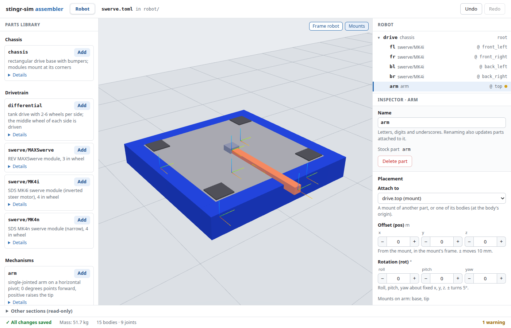
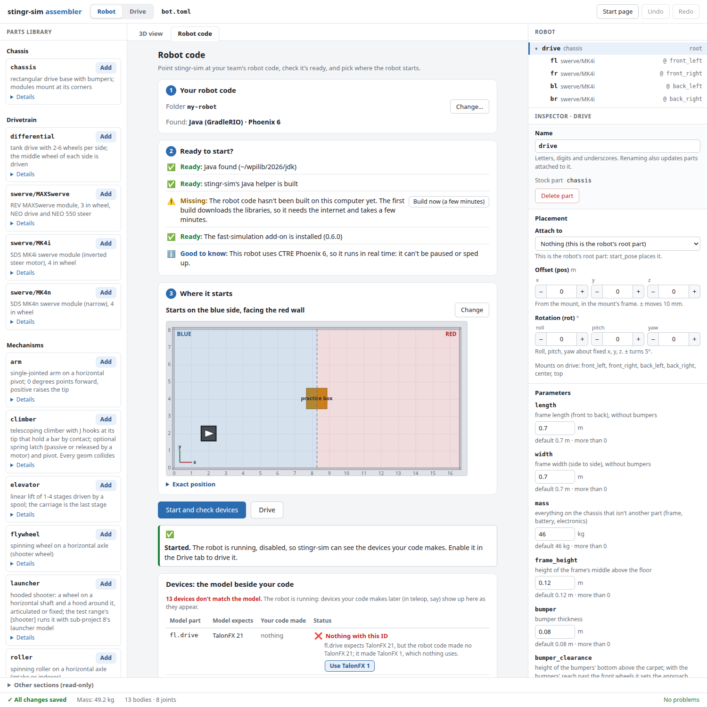

# The assembler

`scrimmage edit` opens a local web page that edits a robot config (the `[[part]]` entries) with a parts
library, a 3D view and live validation. It reads and writes the same TOML file you would edit by hand.
Open a scenario file with the same command and the page gains a Scenario tab: see [the scenario editor](scenario-editor.md). Open a bench file or a folder of them and the page is the Bench tab for mechanism ideas: see [the Bench tab](bench-tab.md).



Contents: [Starting it](#starting-it), [The three columns](#the-three-columns), [Adding parts](#adding-parts),
[Attaching and moving](#attaching-and-moving-parts), [Parameters and device IDs](#parameters-and-device-ids), [The robot code panel](#the-robot-code-panel),
[Errors and warnings](#errors-and-warnings), [Undo](#undo), [Read-only cases](#read-only-cases),
[What it never touches](#what-it-never-touches), [Units](#units), [Keyboard shortcuts](#keyboard-shortcuts),
[Troubleshooting](#troubleshooting).

## Starting it

```bash
scrimmage edit                                    # no file: a start page (recent files, Browse, New ...)
scrimmage edit configs/swerve.toml                # edit an existing config
scrimmage edit examples/bench                     # a folder of bench files, or one bench file: the Bench tab
scrimmage edit my_robot.toml --new swerve         # write a starting swerve robot first, then edit it
scrimmage edit my_robot.toml --new swerve-rev    # a REV MAXSwerve robot (see rev.md)
scrimmage edit my_robot.toml --new differential
scrimmage edit robot.toml --port 8765             # a fixed port (default: any free one)
scrimmage edit robot.toml --no-browser            # only print the URL
```

It prints a link like `http://127.0.0.1:41873/#token=...` and opens it in your default browser. The server listens
on 127.0.0.1 only, and every request needs the token in that link, so other programs and web pages on the machine
can't edit your file.

With no file, the page shows a **start page**: your recent files and folders, **Browse…** to click through folders for a
robot config, scenario, bench file or folder of bench files, and **New robot**, **New scenario** and **New idea session**.
The **Start page** button in the top bar goes back there, and opening something else replaces what is open (it is
refused while a drive session or a run is going). A file opened any way is remembered under Recent.

`--new` refuses to overwrite an existing file. Stop the server with Ctrl+C.

## The three columns

- **Left: Parts library.** The stock parts (chassis, drivetrains, swerve modules, mechanisms), each with a one-line
  description and **Details** for its parameters, mounts and device-ID slots; and **Part folders**: every folder
  holding a `part.toml` next to your config or in a `parts/` folder next to it (`parts/<name>/part.toml`, where the
  FreeCAD exporter puts them). Use the form at the bottom to add another folder (a path relative to the
  config, or absolute). A folder whose `part.toml` has an error is listed with the error and can't be added.
- **Middle: 3D view.** The robot as it will be assembled. Drag to orbit, right-drag to pan, scroll to zoom; **Frame
  robot** fits it in the view. Click a part to select it; hovering a part highlights its row in the tree and the
  other way round. The colored triads are mounts (where parts attach); **Mounts** hides them.
- **Right: Robot and Inspector.** The tree shows each part, what it attaches to, and a dot when it has problems.
  The inspector edits the selected part.

The bottom bar shows whether the file is saved, the robot's mass, body and joint counts, and the number of
errors and warnings. **Other sections (read-only)** shows the rest of the file (`[robot]`, `[field]` and so on).

## Adding parts

Press **Add** on a library entry. The dialog asks for an instance name (letters, digits and underscores; joints and
bodies get it as a prefix) and what to attach to, from a list of mounts and bodies. **Pick in 3D** closes the dialog
so you can click a highlighted mount triad in the view instead; Esc or **Cancel** goes back. The new part is
written to the file and selected.

## Attaching and moving parts

Select a part and use **Placement** in the inspector: **Attach to** moves it to another mount or body, and
**Offset** (meters) and **Rotation** (roll, pitch, yaw in degrees) place it relative to that mount, with +/- buttons
that step 10 mm and 5 degrees. A number box with text that isn't a number shows "Enter a number." and nothing is
sent. An attach the config can't build (an unknown mount, a loop) is rejected with an error and the file is left as it was. Parts attached to a part move with it. Renaming a part also rewrites every `attach` that points at it,
but not scenario files that use its names (such as `joint.<part>.<joint>`); update those yourself. **Delete part** is
refused while other parts are attached to it.

## Parameters and device IDs

The inspector lists the part's parameters with their units, defaults and limits. A value equal to the default is
removed from the file (the file stays short); **Reset** next to a changed value puts the default back. **Device IDs** has one row
per slot (a motor, an encoder, a gyro): type `PWM:3`, `DIO:4`, `TalonFX:3`, `CANcoder:9` or `Pigeon2:13`, or use
**Table** for a full table and **Per motor** when a slot drives several motors. Leave a slot empty to leave it
unbound. A field is saved when you press Enter or leave it.

## The robot code panel



Above the 3D view, **3D view | Robot code** switches the middle column to a panel that points the robot file at your
team's real robot code. It has three numbered parts.

1. **Your robot code.** **Browse…** (**Change…** once a folder is set) to the project (the folder with `build.gradle`, or `robot.py`) and **Use this
   folder**. It says what it found, such as `Java (GradleRIO) · Phoenix 6`, and writes the `[robot_program]`
   section (and nothing else). A folder that isn't a robot project is refused with a reason and nothing is written.
2. **Ready to start?** A checklist of ready, missing and good-to-know items. A missing item has a fix button: **Build
   it** (Scrimmage's Java helper), **Build now** (the project, which can take minutes the first time) or **Install
   it** (the lockstep add-on). The output shows while it works, and a failure stays in that row with **Try again**. A
   CTRE (Phoenix 6) robot gets a note that it runs in real time.
3. **Where it starts.** There is no default start. **Pick on the field** opens a picker: choose the **2026 field**
   (REBUILT) or the **Plain field** (red and blue), then click to place the robot, hold the button down and drag to
   turn it (arrow keys move it, `[` and `]` turn it). The 2026 field has named starts (one click) and a **No balls on
   the floor** switch, because 360 balls make it slower. **Exact position** holds the numbers. **OK** writes the
   start; **Cancel** (or Esc) takes back what you changed in the picker, without undoing someone else's edit.

**Start and check devices** starts the robot disabled and keeps it running; **Drive** starts a Drive session. Both
ask for a start first, and so does a scenario's **Run**. Java code that hasn't built on this computer yet (or whose
last **Build now** failed) doesn't start: the panel says so, with **Build now** beside it, and the Drive tab's banner
and the Scenario tab's **Run** link to it. While the robot runs, **Stop the robot** stops it.

**The device table** (under the buttons, once a check or a drive has run) puts the model beside your code, one row
per motor, encoder or gyro: **Model part**, **Model expects**, **Your code made** and a status (matches, waiting,
nothing with this ID, not in the model, another type, or "not checked yet" for devices Scrimmage can't see, such as
PWM and DIO). A row with nothing under its ID offers **Use …** for each device of the same type that your code made;
**Apply the matches and restart** (**Apply the matches** while nothing is running) writes all your choices in one edit and restarts the robot (it says "restarting", then
whether the robot started again; one **Undo** takes the edit back). A device the model doesn't have has **Add as…**, which selects the part to put it on. The rows stay after the
robot stops, and the Drive tab shows a line while any don't match. The same notes go into a scenario's `report.md`,
`report.json` and printed summary.

**Brake or coast, and invert.** Scrimmage can't read these from your code, so each motor slot in the inspector has
**When stopped** (Default, Brake or Coast) and **Invert (turn the other way)**. Each change is one edit.

**More settings** at the foot of the panel holds the battery's voltage and resistance (`[battery]`).

**Team folders.** A path in a robot file can say `{cad}` or `{code}`; the start page's **This computer's team
folders** card sets where those are on this computer (or `SCRIMMAGE_CAD` and `SCRIMMAGE_CODE`, which win). If the open
file needs one that isn't set, the page asks for it and the file stays read-only until you do.

## Errors and warnings

An edit that would make the config invalid is rejected: nothing is written, and the message appears next to the
field it is about (for example "unknown device type" under a bad ID). Problems that have no field on screen, and
all warnings, are listed above the status bar, with the part's name as a link. The status
bar counts them. A part with problems has a dot in the tree.

## Undo

**Undo** and **Redo** (top right) step through this session's edits; the file is rewritten each time. The server
keeps the history in memory, so it survives reloading the page; it starts again when the file is changed by
something else or when you restart `scrimmage edit`. An undo that would restore text that no longer validates
is refused.

## Read-only cases

The page then shows a banner, disables editing and keeps showing the file. It happens when:

- the file is not valid TOML, or the config has errors the assembler can't edit around (fix them in a text editor);
- the robot is hand-written MJCF (`[model] mjcf = ...`): the assembler edits `[[part]]` robots only.

If you edit the file in a text editor while the page is open, the page reloads it within a moment (and starts the
undo history again). If you save a fix, editing comes back by itself.

## What it never touches

Only the `[[part]]` entries change. Comments, blank lines, the order of everything, and all other sections
(`[robot]`, `[field]`, scenarios, bindings) stay byte for byte as written; a new part is appended after the last
one, after a blank line (in a file with no parts yet, the first `[[part]]` goes at the end of the file). A new key in
an existing part goes after its last key, above the comments that introduce the next part; `pos` and `rot` go right
after `attach` (or after `stock`/`path` on the root part). Deleting a part also deletes the comment lines directly
above its `[[part]]` (a comment separated from it by a blank line, such as a section heading, stays), and the
comments above the next part stay with that part. Writes are atomic (a temporary file, then a rename), and the assembler refuses to write over a file that
changed since it last read it. It never reads or writes anything outside the config and the part folders in the
library.

## Units

**Settings** in the top bar has **Units: Imperial | Metric** (Imperial is the default). Every tab shows and takes
lengths, speeds, masses, forces and pressures in the chosen units, and a box takes a unit typed after the number
(`4 in`, `100 mm`). Your files keep their own units whatever you pick. See [Settings](settings.md) for the table,
typing, files, the command line's `--units` and what stays fixed.

## Keyboard shortcuts

| Keys | Action |
| --- | --- |
| Ctrl+Z (Cmd+Z) | Undo, when focus is not in a text box |
| Ctrl+Shift+Z or Ctrl+Y | Redo, when focus is not in a text box |
| Enter | Save the field you are typing in |
| Esc | Leave "Pick in 3D" and return to the Add dialog |

Inside a text box Ctrl+Z undoes your typing in that box, as usual.

## Troubleshooting

- **"port N is in use".** Choose another with `--port`, or leave it out to take any free port.
- **The browser didn't open.** (Headless machine, or `--no-browser`.) Copy the printed URL, including the
  `#token=...` part, into a browser on the same machine. Over SSH, forward the port first
  (`ssh -L 8765:127.0.0.1:8765 host`, started with `--port 8765`).
- **"This page needs the link ... (it carries a #token=...)".** The URL lost its token. Use the one the command
  printed; it changes on every start.
- **"Not connected".** The server stopped; start it again and open the new link.
- **The 3D view says WebGL isn't available, or that it lost its graphics context.** Everything else keeps working.
  Reload the page, or enable hardware acceleration in the browser.
- **A part folder I added, changed or fixed on disk doesn't show up.** The assembler doesn't watch part folders
  for changes (it does watch the config file itself). Re-open the page, or make any edit, to refresh the library.
- **"The robot changed outside this page".** The file was edited elsewhere (or in another tab), so it was
  reloaded; look at it and redo what you wanted.

The page's tests run in headless Chromium (`pytest -m browser`); see the top of `tests/test_assembler_browser.py`.
