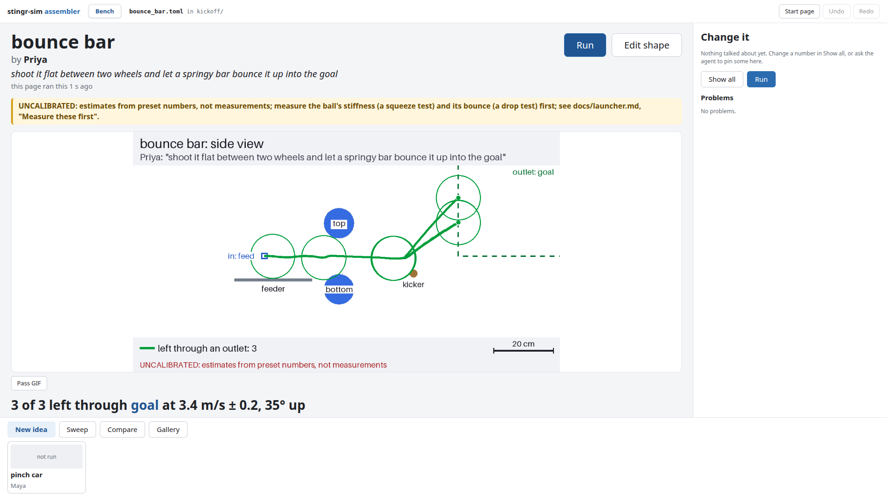

# The Bench tab

The Bench tab is a page in your browser for trying mechanism ideas. You (or the room) see the newest idea, its
numbers and its picture, change a number and press **Run**. An AI agent can work on the same ideas at the same time,
and anything it does shows up on the page within a second or so. It is the same bench as `scrimmage bench`, and it
reads and writes the same plain-text bench files ([the bench guide](bench.md) has the file format).



Contents: [Starting it](#starting-it), [The start page](#the-start-page), [The stage](#the-stage),
[Change it](#change-it), [Edit shape](#edit-shape), [Other ideas and session tools](#other-ideas-and-session-tools),
[With an agent](#with-an-agent), [Where things are saved](#where-things-are-saved), [Troubleshooting](#troubleshooting).

> **Every result says `UNCALIBRATED`.** The ball and tread numbers are estimates until someone measures them. Compare
> ideas with each other; don't read the numbers as exact.

## Starting it

In the `scrimmage` folder, with the venv active:

```bash
scrimmage edit
```

A browser tab opens on the start page. To go straight to an idea, give it a folder of ideas or one bench file (the
folder holding that file becomes the session):

```bash
scrimmage edit examples/bench
scrimmage edit examples/bench/bounce_bar.toml
```

The command prints a link and keeps running; press Ctrl+C in the terminal to stop it. Use `--no-browser` to only print
the link. It needs `pip install -e .`, no extras. (`scrimmage edit` also edits robots and scenarios; see
[the assembler](assembler.md).)

Keep your own ideas in their own folder rather than `examples/bench`, because every run writes its results
folder beside the bench file.

## The start page

`scrimmage edit` with no file shows:

- **Recent**: the files and folders you opened lately. Click one to open it.
- **Browse…**: click through folders to open a robot config, a scenario, a bench file or a folder of bench files.
- **New robot**, **New scenario** and **New idea session**: type a name and the page makes it and opens it. A new idea
  session is a new folder. (A new scenario asks which robot it is for, and a new robot which template to start from.)

The **Start page** button in the top bar comes back here from any tab. Opening something else replaces what is
open; it is refused while a run or a driving session is going, and says so.

## The stage

The stage is the newest idea: the one that was edited or run last, by anyone. It shows:

- the idea's name, who it is from, and what it is, in big type;
- a line saying who last touched it ("the agent ran this 5 s ago", "this page ran this ...", "changed outside this
  page ...");
- the side picture, full width: the wheels, bars and hoods, the path of every ball, and where it left. **Pass GIF**
  switches to the animation of one ball going through, and back;
- the headline results in large type, for example "3 of 3 left through `goal` at 11.2 ft/s ± 0.7, 35° up" (in the
  [Units setting](settings.md)), and always
  a separate `UNCALIBRATED` line;
- **Run** (run this idea now) and **Edit shape**.

A banner says when someone else is running (the agent, or `scrimmage bench run` in a terminal): "agent is running
bounce bar". A run that fails shows "The run failed" and the reason. If the simulation's own energy check fails, the
page says the simulation went wrong, not your design; tell the person who runs scrimmage.

If an idea has never been run, the stage says so and shows no picture: press **Run**.

**A sweep or a comparison** (from this page, the agent or a terminal) takes the stage when it finishes: its chart (a
sweep's exit speed against the number swept, or a comparison's side views side by side), a table of its numbers (one
row per value or per idea) and its `UNCALIBRATED` line. It stays there until the next edit or run of any idea. Each
idea keeps its own last run: click an idea in the strip to see it, and the card named **The comparison** (or **The sweep**)
in the strip to bring the result back.

## Change it

The panel on the right is for the numbers being talked about.

- **The talked-about numbers** (when there are some) are at the top, each with a plain-words help line and its unit.
  Change a number and press Enter, or click away: it is written into the bench file at once (comments and layout
  stay as they were), and that number moves to the top of the panel. Choices (a material, a shaft) are lists.
- **Show all** lists every number of every shape in the idea, grouped by shape.
- **Run** runs the idea with the new number. Editing doesn't run by itself: change as many numbers as you like, then
  run.
- **Problems** lists what is wrong with the idea, the first problem in each part (one per entry: a wheel, a bar, the
  piece), with the number it is about. A change that would make the
  idea worse (a negative diameter, say) is refused: the page shows why and the file is left as it was.
- **Undo** and **Redo** (top bar, or Ctrl+Z and Ctrl+Shift+Z when you aren't typing in a box) step through the
  edits to the idea on the stage.

If the agent changes the idea while you are typing, your edit is refused and the page says "the agent changed this
idea; your edit to ... wasn't saved". Look at what it set, then type yours again.

A shape from an included file (a bench file can include shared shafts, say) is shown read-only, marked "from
`<file>`". Edit it in its own file, or use **Edit here instead** in Edit shape.

## Edit shape

**Edit shape** opens the 3D editor for the idea on the stage. **← Back to the stage** (or Esc) returns.

- **Left: the parts list**, every shape, shaft and setting in the idea (the bench, the piece, the wheels, bars,
  hoods, the green inlets where pieces start and the orange outlets they must reach). A red dot means a problem.
- **Middle: the 3D view.** Drag to turn it, right-drag to move, scroll to zoom. Hover a shape to see what it is;
  click it to select it. **Frame** fits everything; **Zoom to selected** fits the selected shape.
- **Right: the inspector** for the selected entry. Every number has its help text and unit, and a **-** and **+**
  box to nudge it (10 mm, 5° or half an inch at a time). Moving a bar given by its two ends moves both ends. A
  number you type is saved on Enter.
- **Add** buttons: Wheel, Plate, Bar, Hood (curve), Inlet, Outlet, CAD part and Shaft. The new entry is selected, ready
  to change. **CAD part** asks for a part folder exported from FreeCAD, or the path of an STL or OBJ mesh and its
  units.
- **Rename** changes an entry's name everywhere the file mentions it. **Delete** removes it; it refuses while
  something still uses it (a shaft with wheels on it) and says what.
- **Undo** and **Redo** work here as on the stage.

While the editor is open, the idea stays put even if the agent works on another one.

## Other ideas and session tools

Under the stage is a strip with every other idea in the folder (every idea, while a sweep or comparison is on stage),
newest first, with a small picture, its name and who it is from. Click one to look at it (the page puts the newest idea back on stage when it changes). A red dot means the
file has a problem.

The buttons above the strip:

- **New idea**: a name, who it is from, what it is, and **Blank** or one of the examples to start from, then **Make it**. It is written
  into the folder and goes on stage.
- **Sweep**: try one number at several values and see exit speed against it. Pick the number (the talked-about ones
  are listed first), from, to and how many steps. The bench file is not changed. The chart goes on stage and the
  results in `<idea>-sweep/`.
- **Compare**: tick two or more ideas, press **Compare** and they run with the same piece and feed, side by side: one picture and a table on the stage (`compare-results/`).
- **Gallery**: writes `gallery.html` for the folder and opens it in a new window: every idea with its author,
  picture and numbers. It also works emailed, with no server.

Jobs run one at a time. While another one is running, the new one waits ("Waiting: the agent is running ...").

## With an agent

Connect Claude Code as in [the install, step 5](getting-started/install.md#5-optional-connect-claude-code), start
`scrimmage edit` on a folder in one terminal window, and tell the agent to use that folder (give it the absolute path:
`pwd` in that folder prints it). Put the browser on the projector and the agent's terminal beside it.

- When the agent writes or changes a bench file, the idea appears or updates on the page, and the line under the
  name says who did it.
- When the agent runs the idea (`bench_run`), a banner shows while it runs, then the picture and headlines appear.
- The agent can pin the numbers the room is talking about (`bench_focus`): they float to the top of **Change it**.
  Say "pin the squeeze on the screen".
- You and the agent can both edit; the page and the agent take turns on runs, one at a time.

Nobody has to ask the agent to open pictures any more. The room sees what the agent sees.

## Where things are saved

- Your ideas are the `.toml` files in the folder, exactly as the page or the agent wrote them. Open them in any text
  editor; the page picks up your changes.
- Results go beside each file: `<idea>-results/` (summary, CSVs, pictures), `<idea>-sweep/`, `compare-results/`, and
  `gallery.html`. A rerun overwrites its folder.
- A hidden `.scrimmage-bench/` folder in the session folder holds what the page, the agent and the command line share: a
  log of runs, the pinned numbers and who is running now. It is safe to delete when nothing is running; you only lose
  the "latest run" history on the page. Don't put it in git (add `.scrimmage-bench/` to `.gitignore`).

## Troubleshooting

- **The page says "Not connected".** The command stopped. Start `scrimmage edit` again and open the new link.
- **"This page needs the link ... (it carries a #token=...)".** Use the link the command printed, which changes every
  time.
- **No picture, "not run".** The idea hasn't been run yet. Press **Run**.
- **The 3D view says WebGL isn't available.** The list and inspector still work. Reload, or turn on hardware
  acceleration in the browser.
- **Run does nothing and says "Waiting".** Someone else (the agent, or `scrimmage bench run`) holds the run. It goes
  when they finish. If nothing is running, check for a stuck `scrimmage bench` command in another terminal.
- **Run is refused.** An idea with errors can't run. **Problems** lists each one with its
  number; or run `scrimmage bench check <file>` to see them all.
- **A change was refused.** The message under the field says why. Nothing was written.
- **Can't open another file: "a run is in progress".** Wait for the job to finish.
- Anything else: copy the message to the mentor who runs scrimmage.
