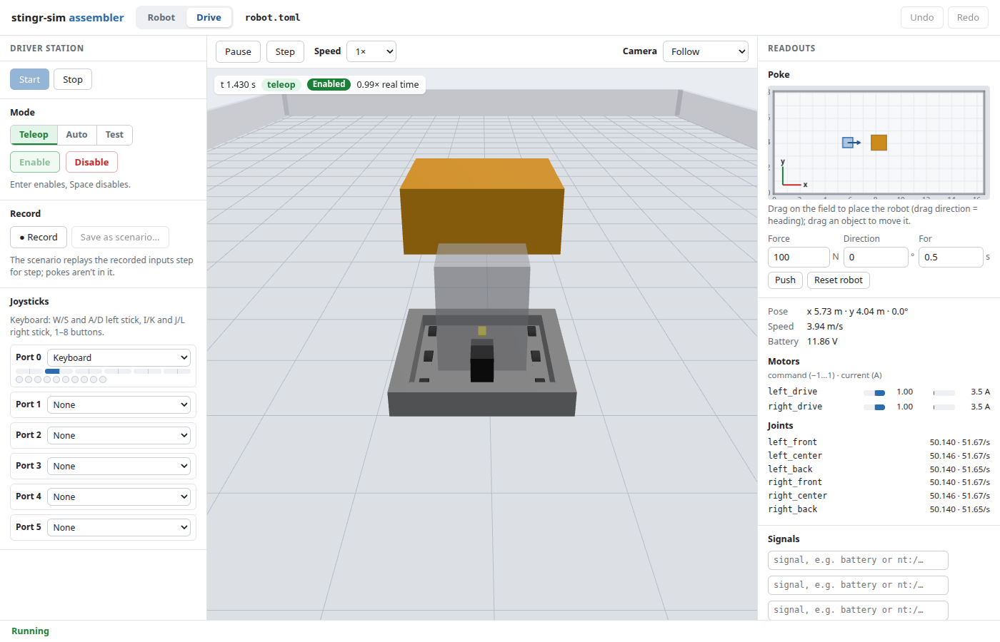

# Driving your robot in the browser

The **Drive** tab of `scrimmage edit` runs your real robot program and lets you drive it from the keyboard or a
gamepad, watching it in 3D. You act as the Driver Station: pick a mode, enable the robot, drive, pause, step and poke
it, then record what you did as a scenario that replays the same inputs.



Contents: [Starting a session](#starting-a-session), [The Driver Station](#the-driver-station),
[Keyboard and gamepad](#keyboard-and-gamepad), [Simulation controls](#simulation-controls), [Poking the robot](#poking-the-robot),
[Readouts and signals](#readouts-and-signals), [Recording and saving](#recording-and-saving),
[Input tracks (the CSV format)](#input-tracks-the-csv-format), [Watching scenario runs](#watching-scenario-runs),
[Safety](#safety), [One simulation at a time](#one-simulation-at-a-time), [Troubleshooting](#troubleshooting).

To drive with the real FRC Driver Station app and your team's gamepad instead of this page, pick **The FRC Driver
Station app** before Start: see [driving with the FRC Driver Station app](driver-station.md).

## Starting a session

```bash
scrimmage edit configs/kitbot.toml        # opens the page; click the Drive tab, then Start
```

Open a robot config (or a scenario: its **Drive this robot** button opens the Drive tab for the scenario's robot).
Click **Start**. Scrimmage launches the config's `[robot_program]` (the same command `scrimmage run` uses), connects
to it and shows the robot in the live view. The status line at the bottom reads Not started, Starting the robot
program, Running, Paused, Stopped or Error. **Stop** ends the session; after an error, **Restart** starts again.
When the robot code panel restarts a running robot on new IDs, the Match settings and game data stay (a restart is
the same match); a new Start, or Restart after an error, begins again from the config's `[match]`.

The Robot tab's **Robot code** panel can start the session too: its **Drive** button asks where the robot starts
(there is no default), then opens this tab and starts. Where the robot code panel's device check finds devices that don't
match the robot file, a line under the status says how many, with a link back to the panel. See
[the robot code panel](assembler.md#the-robot-code-panel).

**Start** is disabled, with the reason beside it, when the robot config doesn't load (fix it in the Robot tab) or has
no `[robot_program]` section. Hand-written `[model]` robots can be driven like any other. Like `scrimmage run`, a
real-time-capable robot program needs the lockstep extension on Linux (see the README's quick start).

One **robot step** is the config's `[lockstep] step` (20 ms by default). Everything below that counts in steps
(Step, recorded rows, replay) uses that.

## The Driver Station

The controls are in the left column.

- **Driver Station** (above Start): **Scrimmage (this page)**, the controls below, or **The FRC Driver Station
  app**. It starts at the config's `[driver_station] real` and is fixed while the robot runs: to change it, stop
  and start again. With the app, a box says "The FRC Driver Station is driving" with what the app is doing, and
  the controls below, Pause, Step and Record are off. See [the FRC Driver Station app](driver-station.md).

- **Mode:** Teleop, Auto or Test. Pick it before you enable; the robot program sees the mode you chose. Changing
  the mode while the robot is enabled switches the robot to the new mode at once.
- **Enable / Disable.** The robot starts disabled. Press **Enter** to enable and **Space** to disable. Space always
  disables, even when a button has focus (it doesn't press that button), so it always works as a stop key.
  Enter on a focused button presses that button instead. Both keys are ignored while you type in a text box (so
  typing never drives the robot or enables it) and while the Save dialog is open.
- **Joysticks:** ports 0 to 5, each set to None, the Keyboard or a gamepad (below). Small bars show each port's
  axes and buttons, so you can see what the robot is being sent.
- **Match:** the **Station** menu (red1 to blue3), the **Game data** box, and the **FMS attached** and **Match timer**
  checkboxes. They start at the robot config's `[match]` when you press Start. The station, FMS and timer reach the
  robot at once. The game data box works like the real Driver Station's: the robot gets it each time it is enabled in
  Teleop, and a change made while it is enabled in Teleop is sent when you press **Enter** or leave the box. There
  are no fields for the Auto and Teleop lengths: set `auto_seconds` and `teleop_seconds` in the config's `[match]`.
  See [match data](match.md#in-the-drive-tab).

## Keyboard and gamepad

Port 0 starts on the keyboard. Browsers only show a gamepad after you press one of its buttons; the first gamepad
that shows up then takes port 0 from the keyboard (a notice says so), unless you have already set port 0 yourself.
Pick a source per port in the Joysticks list. Keys pressed in a text box belong to it and never reach the robot.
The driving keys (below) always drive, even with a Drive-tab list (camera, speed, a joystick port) focused, and
picking from one of those lists hands the keys straight back to driving.

Keyboard (shaped like WPILib's `XboxController`, so a robot written for a real controller works unchanged):

| Keys | Input | `XboxController` |
|------|-------|------------------|
| A / D | left stick X, A = -1 | `getLeftX()`, axis 0 |
| W / S | left stick Y, W = -1 (forward is negative, as on a real controller) | `getLeftY()`, axis 1 |
| J / L | right stick X, J = -1 | `getRightX()`, axis 4 |
| I / K | right stick Y, I = -1 | `getRightY()`, axis 5 |
| 1 to 8 | buttons 1 to 8 | A, B, X, Y, left bumper, right bumper, Back, Start |

Axes 2 and 3 (the triggers), the stick buttons (9, 10) and the POV stay at rest on the keyboard.

A gamepad with the browser's "standard" layout maps like this:

| Gamepad | WPILib input |
|---------|--------------|
| left stick | axes 0 (X) and 1 (Y), `getLeftX()` / `getLeftY()` |
| left / right trigger | axes 2 / 3, `getLeftTriggerAxis()` / `getRightTriggerAxis()` (0 to 1) |
| right stick | axes 4 (X) and 5 (Y), `getRightX()` / `getRightY()` |
| A, B, X, Y | buttons 1, 2, 3, 4 |
| left / right bumper | buttons 5, 6 |
| Back / View, Start / Menu | buttons 7, 8 |
| left / right stick press | buttons 9, 10 |
| D-pad | POV 0: up = 0, right = 90, down = 180, left = 270 (diagonals 45, 135, 225, 315), none = -1 |

A gamepad that isn't "standard" sends its axes and buttons as the browser numbers them, with no POV. If an assigned
gamepad is unplugged, its port reads zeros at once and a notice says so.

## Simulation controls

Above the live view:

- **Pause / Resume** freezes the simulation. Held inputs stay as they were.
- **Step** (while paused) advances exactly one robot step, then pauses again.
- **Speed:** 0.25x, 0.5x, 1x, 2x or max (as fast as the computer allows).
- **Camera:** Follow, Top, Driver station or Free orbit.

If the robot code uses **Phoenix 6** devices, the speed is locked at 1x with the reason shown next to it, because
Phoenix 6's own simulation runs on the wall clock: the robot runs in real time, not lockstep. Pause and Step can't
stop it: the robot program and physics keep running.
The same happens when the FRC Driver Station app drives (it talks to the robot on the wall clock); then Pause and
Step are off.

A small bar over the view shows the sim time, the mode, whether the robot is enabled, the match time (while the
Match timer is on), and how fast the simulation is running against real time.

## Poking the robot

The **Poke** panel (top right) is a small top-down drawing of the field. Use it to set up or disturb a run without
restarting:

- **Drag on the field** to put the robot there, facing the way you dragged. A plain click keeps its heading.
- **Drag a game piece** (any free body in the world) to move it. Walls and other fixed obstacles can't be dragged.
- **Push** applies a force (N) in a field direction (0 degrees is +x, 90 degrees is +y) for a number of seconds.
- **Reset robot** puts the robot back at its start pose.

The panel is grayed out and takes no drags until you press **Start**, and again once the session stops. A drag while
the robot program is still starting is applied as soon as the session runs.

Pokes aren't saved in a recording: see below.

## Readouts and signals

The right column shows the robot's pose, speed, battery voltage, each motor's command and current, each joint's
position and speed, and the console tail of the robot program.

**Signals** plot up to four values over the last few seconds of simulation time. Type a name or pick one from the
list: `battery`, a motor, a joint, a contact or a NetworkTables entry such as `nt:/SmartDashboard/Speed`. These are the
same names the scenario checks use.

## Recording and saving

1. Press **Record**. Everything from the next robot step is recorded: the joystick inputs of every port and the mode
   changes (a new scenario step starts each time the effective mode changes, including Enable and Disable, and each
   time the robot's game data changes). The match settings you have when you press Record become the scenario's
   `[match]`: station, FMS and timer changes made during the recording aren't saved, so set them before Record.
2. Drive. Press **Record** again to stop.
3. Press **Save as scenario...**, enter a file name (for example `scenarios/my_drive.toml`) and Save. A scenario
   that exists is not overwritten unless you confirm, and only an earlier recording is ever replaced (a scenario
   whose first line is the `# Recorded in the Drive tab` comment, with its folder of track files). A hand-written
   scenario, a robot config, a folder with no recording beside it, or a folder holding anything but the recording's
   track files is refused whatever you answer: choose another name.

Scrimmage writes `my_drive.toml` and a folder `my_drive/` beside it holding one input track per step
(`step1.csv`, `step2.csv`, ...). The new scenario opens in the Scenario tab, where you can edit, trim and run it. Add
checks to turn a drive you liked into a regression test.

A recording lasts until the next session starts. When you press **Start** (or **Restart**) and the last drive's
recording hasn't been saved, the page asks "Start a new session and discard the recording?" first: **Cancel** keeps it
so you can save it, **Discard and start** drops it and starts. A recording you have saved (and haven't recorded over
since) goes without asking.

Pokes you made while recording are **not** in the scenario (a push or a moved game piece can't be replayed from the
scenario format yet). The record button counts them, and the save dialog warns when there were any. Replaying then
differs from the drive wherever a poke mattered.

A recording replays the inputs on robot-step boundaries, so a lockstep replay sends the robot the same inputs on the
same steps as the drive did.

## Input tracks (the CSV format)

A scenario step can take its inputs from a CSV instead of constant values:

```toml
[[step]]
name = "teleop 2"
mode = "teleop"
duration = 4.2
inputs = "my_drive/step2.csv"      # relative to the scenario file
```

```
t,p0.axis0,p0.axis1,p0.axis2,p0.axis3,p0.axis4,p0.axis5,p0.button1,p0.button2,p0.pov0
0.0,0.0,0.0,0.0,0.0,0.0,0.0,0,0,-1
0.02,0.0,-0.5,0.0,0.0,0.0,0.0,0,0,-1
0.04,0.0,-1.0,0.0,0.0,0.0,0.0,1,0,-1
```

- The first column is `t`, the seconds since the start of the step. It is 0 or more and strictly increasing.
- The other columns are `p<port>.axis<i>` (numbered from 0), `p<port>.button<i>` (numbered from **1**, as WPILib
  does) and `p<port>.pov<i>` (from 0). Ports are 0 to 5. A kind's columns must be contiguous (no `button3` without
  `button1` and `button2`), and every row has every column.
- Axes are numbers from -1 to 1, buttons are 0 or 1, and a POV is -1 (released) or 0 to 359 degrees.
- Each row applies from its `t` until the next row (zero-order hold); after the last row the last inputs are held
  until the step ends. If no row is at `t = 0` the inputs are all at rest until the first row. The last `t` can't be
  past the step's `duration`.
- A step with `inputs` can't also have `axes`, `buttons` or `povs`.

A problem in the file is reported with its line number, for example `step2.csv: line 7: p0.axis1 must be a number
between -1 and 1, not 'fast'`, and shows as an error on the step in the Scenario tab. Recorded files have a row on
every robot step; hand-written ones can have as few rows as you like.

In the Scenario tab a step with `inputs` shows a plot of the track: axes as lines and buttons or POV as lanes. See
[the scenario editor](scenario-editor.md#input-tracks).

## Watching scenario runs

In the Scenario tab, **Watch** (next to Run) opens the same 3D view for a scenario run in progress. It is a view only:
you can't drive a run. Watch needs no extra setup; it uses the same connection as the Drive tab.

## Safety

- **Inputs go to zero** if the page stops sending them for 0.5 s (a frozen tab, a sleeping laptop).
- **Closing or reloading the page** disables the robot and pauses the session. The session stays up: come back to the
  Drive tab and it shows the session paused. Press **Resume** (and **Enable**) to continue; nothing resumes by itself.
- **Stop**, or ending `scrimmage edit` (Ctrl+C), kills the robot program.
- Pressing Space disables the robot from anywhere on the Drive tab, except while you are typing in a text box.

## One simulation at a time

A drive session and a scenario run can't be active together. **Start** says "a scenario run is in progress" while a run
goes, and **Run** is refused while a session is live. Stop one before starting the other. The MCP server's own
simulations are separate processes.

While a session is starting, running or paused, the robot it drives stays the page's robot. Opening a scenario (a
recording you have just saved, for example) works when the scenario's `config` is that same robot config, however
the path reaches it; a scenario that names another robot config, names none, has a TOML error or names a file that
can't be read is refused with "a drive session is live". In the Scenario tab, an edit, Undo or Redo that would change
`config` to another robot is refused the same way. An outside edit (in a text editor) of the scenario's `config` can't
be refused: the page follows it at once, while the session keeps driving the robot it started with until you stop it.

## Troubleshooting

- **Start is disabled:** read the reason beside it (the robot config doesn't load, or has no `[robot_program]`).
- **The robot ignores the keyboard:** it must be enabled; check the port is set to Keyboard and that the focus isn't
  in a text box (click the live view first).
- **The speed stays at 1x:** the robot uses Phoenix 6 devices; see [Simulation controls](#simulation-controls). Or
  the FRC Driver Station app drives it, which runs in real time too ([driver-station.md](driver-station.md)).
- **Mode, Enable and the joystick ports are off:** the Driver Station choice is **The FRC Driver Station app**. Use
  the app, or stop and pick **Scrimmage (this page)**.
- **"N devices don't match the model":** your code made different CAN IDs or device types than the robot file expects. **see Robot code** opens the device table, which can apply the matches.
- **Error status:** the robot program failed to start or exited; the console shows its output. **Restart** after fixing it.
- **Gamepad not listed:** press a button on it with the page focused; browsers hide gamepads until then.
