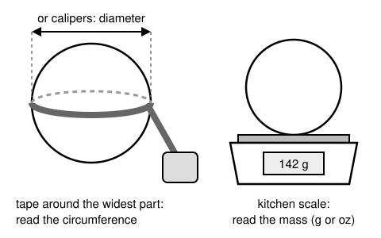
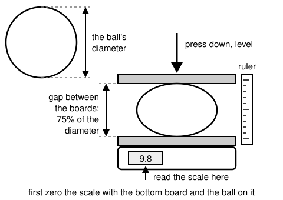
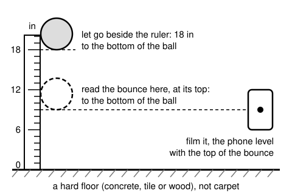
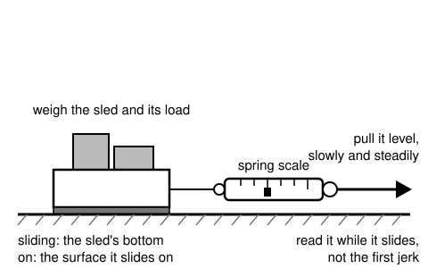
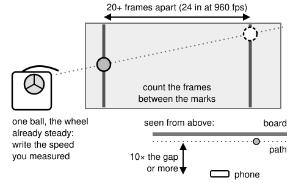
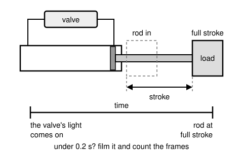

# Measuring your own numbers

Scrimmage marks its results UNCALIBRATED because most of the numbers they rest on are estimates: how hard a ball
is to squeeze, how high it bounces, how well a wheel's tread grips it, how fast a valve lets air through. This page
shows how to measure those numbers with a bathroom scale, a tape measure, a spring scale and a phone that films slow
motion, how to write your trials down, and how to make a run use them. A result whose numbers are all measured (and
good enough) stops saying UNCALIBRATED and says "Calibrated from measurements" instead.

> **A measured number is still a measurement, not the truth.** Every average below has a spread, and every fit has
> a range of values that fit your trials as well as they can tell. Scrimmage prints both, and calls an estimate an
> estimate wherever one is left.

Contents: [The six tests](#the-six-tests) (and two by hand for a NOTE), [How it goes](#how-it-goes), [The forms](#the-forms),
[The Measure tab](#the-measure-tab), [A measurement file](#a-measurement-file),
[Reading a file: `scrimmage measure`](#reading-a-file-scrimmage-measure), [Ball size and mass](#ball-size-and-mass),
[Ball squeeze](#ball-squeeze), [Ball drop](#ball-drop), [Sled pull](#sled-pull), [Launcher shot](#launcher-shot),
[Cylinder stroke](#cylinder-stroke), [How the averaging works](#how-the-averaging-works),
[How the launcher fit works](#how-the-launcher-fit-works), [How the cylinder fit works](#how-the-cylinder-fit-works),
[Using a measurement](#using-a-measurement), [The labels](#the-labels),
[What isn't covered yet](#what-isnt-covered-yet).

The worked examples are in [`examples/measure`](../examples/measure/README.md): a FUEL ball, a tread's friction, a
launcher's shots, a cylinder's strokes, and two launcher setups that use them.

## The six tests

| Test | File kind | Gives | You need |
|---|---|---|---|
| [Ball size and mass](#ball-size-and-mass) (`size`) | ball | `mass`, `diameter` | a kitchen scale, a soft tape measure (or calipers) |
| [Ball squeeze](#ball-squeeze) (`squeeze`) | ball | `stiffness_n`: the force that squeezes the ball by 25% of its diameter | a bathroom scale, two flat boards, a ruler |
| [Ball drop](#ball-drop) (`drop`) | ball | `restitution`: the bounce | a ruler on a wall, a hard floor, a phone that films slow motion |
| [Sled pull](#sled-pull) (`sled`) | friction | `friction`: the sliding friction of one material on another | a spring scale (or a luggage scale), a sled, weights, a scale |
| [Launcher shot](#launcher-shot) (`shot`) | launcher | the ball's `stiffness_n`, or the wheel's `friction`, fit to the launcher model | a phone at its highest frame rate, a board and tape, the wheel speed from a tachometer or the robot's log |
| [Cylinder stroke](#cylinder-stroke) (`stroke`) | cylinder | the valve's `conductance`, fit to the pneumatic model | a phone that films slow motion (or a stopwatch, for a slow stroke) |

The first four work out their number from each trial by a formula you can do by hand. The last two can't: no
formula turns a filmed shot into a ball's stiffness. For those, Scrimmage runs its own model (the same one a run
uses) many times and finds the number that makes the model match your trials. That is a **fit**.

Two more tests are done by hand, with no form or file: [NOTE squeeze](#note-squeeze) and [NOTE drop](#note-drop).
They give a foam ring's `[piece.note] stiffness` and `restitution` (the 2024 NOTE's are estimates) for a range or
bench file, so the count is six tests for `scrimmage measure` and two by hand.

## How it goes

1. **Print a form** for the test ([The forms](#the-forms)) and take it to where you measure.
2. **Measure.** Do the test at least 3 times (5 is better), writing each trial on its own row.
3. **Type the trials in**: in the [Measure tab](#the-measure-tab), or into a [measurement file](#a-measurement-file)
   (`<name>.measure.toml`) in a text editor.
4. **Check them** with `scrimmage measure <file>` (or in the Measure tab, which shows the same thing as you type):
   the average, the spread, any warnings, and for a shot or a stroke the fit.
5. **Use the file**: name it in your launcher setup, range, test or robot config ([Using a
   measurement](#using-a-measurement)). The result's label then names it.

## The forms

Each test has a printable blank form: the test's picture, what you need, the steps, boxes for who measured it and
when, a setup box, 8 trial rows with each reading's units printed, how each trial's value is worked out, and (for the
four direct tests) boxes for the average, the lowest, the highest and the spread. A form prints on one page, on US
Letter or A4, in black and white.

```bash
scrimmage measure form squeeze -o squeeze-form.html   # write the squeeze test's form, then open it and print it
scrimmage measure form shot                           # or print the page's HTML to the terminal
```

The tests are `size`, `squeeze`, `drop`, `sled`, `shot` and `stroke`. The Measure tab's **Print a blank form** button
opens the same form. Fill it in by hand, bring it back, and type it in.

## The Measure tab

`scrimmage edit fuel.measure.toml` opens a measurement file in the browser, in the **Measure tab**. To start a new
one, run `scrimmage edit` and press **Measure something** on the start page: pick what you are measuring (a ball, a
friction, a launcher or a cylinder file) and give it a name (`fuel` becomes `fuel.measure.toml`, made in the start
page's folder).

The tab shows one test at a time (a ball file has size, squeeze and drop across the top). On the left are the
test's picture, what you need and the steps, the same as the printed form's. On the right:

- **Print a blank form**, the test's printable form.
- Who measured it, when and with what. These are optional: the labels name them when they are given, and
  `scrimmage measure` reminds you to add them.
- The setup, once for all trials (a squeeze's tare, a drop's height and floor, a sled's weight and materials).
- The trials: a row per trial, each reading with a unit picker over its column, the value each trial gives, and a
  flag on a trial that looks off.
- The average, lowest, highest and spread, and any warnings, updated as you type.
- For a shot or a stroke, **Fit**, and the fit's results. A fit takes a few seconds; if you change a trial
  afterward it says "Your trials changed since this fit: press Fit again."

The tab saves on its own, like the other tabs: a moment after you stop typing, or when you leave a box. There is no
Save button. A box with something other than a number where a number goes holds the save back and says so.

## A measurement file

A measurement file is a TOML text file whose name ends in `.measure.toml`. It holds what was measured, and every
trial's readings in the units you read them in. It never holds the averages or the fits: those are worked out from
the trials each time the file is read, so they can't go stale. `scrimmage measure new <test> <file>` starts one with
the test's keys written in as comments. It takes a test (`squeeze`, `shot`), where the tab's **Measure something**
takes a kind of file (a ball, a launcher): a ball file made for one test can hold the others too.

```bash
scrimmage measure new squeeze fuel.measure.toml
```

```toml
[measure]
kind = "ball"                 # what the file measures
about = "a FUEL ball from the practice bin"
by = "J. Smith"
date = 2026-11-10
tools = "bathroom scale, two plywood boards"
base = "2026-fuel"

[squeeze_setup]               # a test's settings, once for all its trials (or in a trial, for that trial alone)
tare_lb = 1.2

[[squeeze]]                   # one table per trial
force_lb = 27.4
```

### `[measure]`

| key | default | meaning |
|---|---|---|
| `kind` | required | `ball` (tests `size`, `squeeze`, `drop`), `friction` (`sled`), `launcher` (`shot`) or `cylinder` (`stroke`) |
| `about` | `""` | what you measured, in words: "a FUEL ball from the practice bin" |
| `by` | `""` | who measured it. Optional, but the labels name it |
| `date` | `""` | when: a date like `2026-11-10`. Optional, but the labels name it |
| `tools` | `""` | what you measured it with |
| `base` | none | a ball file's ball preset (`"2026-fuel"`; the names are in [launcher.md](launcher.md#presets-and-their-sources)): the numbers the file doesn't measure come from it |

A file may hold any of its kind's tests, each as `[[<test>]]` tables (one per trial), with an optional
`[<test>_setup]` table. A ball file may have all three ball tests.

### Units

**Every reading's key ends in the unit you read it in**: `force_lb`, `bounce_in`, `mass_g`. Write what the scale or
the ruler says, and Scrimmage converts it. A key with no unit, or a unit it doesn't know, is an error that lists the
ones allowed. Units are lowercase.

| quantity | units | used for |
|---|---|---|
| force | `n`, `lb`, `kg` | a squeeze's force, a sled's pull, a cylinder's seal friction. A scale's lb or kg is read as the weight of that much mass (1 lb is 4.448 N, 1 kg is 9.807 N) |
| weight | `n`, `lb`, `kg`, `g`, `oz` | a squeeze's tare and a sled's weight: as force, and a kitchen scale's grams or ounces too |
| mass | `g`, `kg`, `oz`, `lb` | a ball's mass, a cylinder's load and rod |
| length | `in`, `mm`, `cm`, `m` | a circumference, a diameter, a drop, a bounce, a squeeze gap, a mark spacing, a cylinder's size |
| time | `s` | a stroke's time |
| frames | `frames` | frames counted on a video: the key is just `frames` |

A few settings are plain numbers whose unit is in their name: `fps` (frames per second), `wheel_rps` (wheel
rotations per second), `hood_deg` (degrees) and `working_psi` (psi).

## Reading a file: `scrimmage measure`

```bash
scrimmage measure examples/measure/fuel.measure.toml
```

prints each test's trials with the value each gives, then the average, the lowest, the highest and the spread, with
any warnings, and for a shot or a stroke the fit. Its last line says whether the file is good enough to use. It
exits 0 when it is, 1 when it isn't yet, and 2 when the file can't be read (the message names the file, the table
and the key). The sections below quote it on the [worked examples](../examples/measure/README.md), in Imperial
units; it prints in the Units setting (`scrimmage --units metric measure ...` for Metric).

## Ball size and mass



**Gives** the ball's `mass` and `diameter`.

1. Weigh the ball on a kitchen scale and write its mass.
2. Wrap a soft tape measure around the ball's widest part, snug but not squeezing it, and read the circumference.
   Or read the diameter straight across with calipers.
3. Turn the ball and measure again for the next trial.

Each trial's diameter is the circumference ÷ 3.1416 (or the diameter you read). A trial may give only a mass, or only
a circumference; each value is averaged over the trials that give it.

| key | in | meaning |
|---|---|---|
| `mass_<unit>` | `[[size]]` | the scale's reading |
| `circumference_<unit>` | `[[size]]` | the tape around the widest part |
| `diameter_<unit>` | `[[size]]` | or the diameter read across with calipers: a circumference or a diameter, not both |

```
size: gives mass, diameter
  trial  mass_g  circumference_in  mass      diameter
  1      215     18.6              0.474 lb  5.921 in
  ...
  mass: average 0.475 lb, lowest 0.472 lb, highest 0.478 lb, spread 1% (5 trials)
  diameter: average 5.914 in, lowest 5.889 in, highest 5.952 in, spread 1% (5 trials)
  good enough to use
```

**Feeds** a launcher's, range's or test's ball (`diameter`, `mass`), and the squeeze test's gap (below).

Form: `scrimmage measure form size -o size-form.html`.

## Ball squeeze



**Gives** the ball's `stiffness_n`: the force that squeezes it by 25% of its diameter between flat boards. It is the
number that matters most in the launcher model ([launcher.md](launcher.md#measure-these-first)).

1. Put the bottom board on a bathroom scale and the ball on the board, then **zero (tare) the scale** with them on
   it. If the scale can't be zeroed, write its reading now as the tare.
2. Put the top board on the ball.
3. Press the top board down, level, until the gap between the boards is 75% of the ball's diameter (a 5.9 in FUEL to
   4.4 in; a 7 in Power Cell to 5.25 in).
4. Hold it there and read the scale: that is the force.
5. Let go, turn the ball, and repeat for the next trial.

The top board's weight presses on the ball too, so it is part of the squeeze: that's why the scale is zeroed before
the top board goes on, not after. Each trial's force is the reading minus the tare (no tare if you zeroed the scale).
If you pressed to some other gap, write it as `squeezed_to_<unit>`: Scrimmage converts the force to the 25% squeeze
with the ball's `stiffness_exponent` (1.5, so force grows as squeeze^1.5), using the ball's diameter from the file's
own size test when it is good, else its base preset's.

| key | in | meaning |
|---|---|---|
| `force_<unit>` | `[[squeeze]]` | the scale's reading, pressed |
| `tare_<unit>` | `[squeeze_setup]` or a trial | optional: the reading with only the bottom board and the ball on it, if the scale couldn't be zeroed. A weight: a kitchen scale's g or oz work too |
| `squeezed_to_<unit>` | `[squeeze_setup]` or a trial | optional: the gap between the boards you pressed to, if it wasn't 75% of the diameter |

```
squeeze: gives stiffness_n, the force that squeezes the ball by 25%
  trial  force_lb  stiffness_n
  1      27.4      27.40 lbf
  ...
  stiffness_n: average 27.68 lbf, lowest 26.80 lbf, highest 28.60 lbf, spread 7% (5 trials)
  good enough to use
```

**Feeds** a ball's `stiffness_n`, and a launcher shot fit: with the squeeze measured, the shots fit the wheel's
friction instead of the ball's stiffness ([Launcher shot](#launcher-shot)).

Form: `scrimmage measure form squeeze -o squeeze-form.html`.

## Ball drop



**Gives** the ball's `restitution`, its bounce.

1. Tape a ruler upright against a wall, its zero on a **hard floor**: concrete, tile or wood, not carpet.
2. Set the phone square-on to the ruler, level with where the top of the bounce will be (about 6.5 in up for a FUEL
   ball), and start filming in slow motion.
3. Hold the ball close to the ruler with its bottom at **18 in**.
4. Let go without pushing it.
5. In the video, find the top of the first bounce and read the ruler at the bottom of the ball: that is the bounce.

Each trial's restitution is √(bounce ÷ drop), both measured to the bottom of the ball. The model's foam is tuned for
an 18 in drop on a hard floor, so another drop height is warned, and so is a floor that sounds soft (carpet, a rug,
turf, a mat, foam tiles) or a floor not named.

| key | in | meaning |
|---|---|---|
| `bounce_<unit>` | `[[drop]]` | the top of the bounce, floor to the bottom of the ball |
| `drop_<unit>` | `[drop_setup]` or a trial | the drop, floor to the bottom of the ball: 18 in |
| `floor` | `[drop_setup]` | what the floor is: `"concrete"` |

```
drop: gives restitution, the bounce
  trial  bounce_in  restitution
  1      6.5        0.601
  ...
  6      5.5        0.553
  restitution: average 0.595, lowest 0.553, highest 0.612, spread 10% (6 trials)
  warning: trial 6 looks off: check it
  good enough to use
```

**Feeds** a ball's `restitution`.

Form: `scrimmage measure form drop -o drop-form.html`.

## NOTE squeeze

**Gives** `[piece.note] stiffness` (N/m): how hard a foam ring pushes back per meter of squeeze, at 25 % of its
thickness. It is for a [soft piece](test-range.md#piecename-a-kind-of-piece) such as the 2024 NOTE. Done by hand;
there is no form.

1. Lay the NOTE flat on a hard, level table with a flat board under it. Put a second flat board on top.
2. Add a known weight on the top board, centered: start with about 1.3 kg (12.7 N), and weigh the board too.
3. Wait 5 seconds, then measure the gap between the boards at both sides with calipers or a ruler, and average.
4. The squash is the NOTE's thickness (2 in, with nothing on it) minus that gap. Aim for about a quarter of the
   thickness (0.5 in); add or remove weight and repeat until you are near it.

Each side of the NOTE carries the whole weight W (boards and weight, in newtons: kg × 9.81), and the two sides share
the squash, so stiffness = W ÷ (squash ÷ 2). A 12.7 N weight that squashes 0.5 in (0.0127 m) gives 12.7 ÷ 0.00635
= 2000 N/m, the preset's estimate. Write the result as `stiffness` in `[piece.note]`, with the range 1000 to 20000
N/m. A foam that creeps (keeps sinking) is read at 5 seconds.

## NOTE drop

**Gives** `[piece.note] restitution`: its bounce off the carpet.

1. Tape a ruler upright against a wall, its zero on the **carpet** the NOTE will meet.
2. Set the phone square-on to the ruler, level with where the top of the bounce will be (a few inches up), and start
   filming in slow motion.
3. Hold the NOTE **flat** with its bottom at **1 m** (39.4 in), then let go without pushing it.
4. In the video, find the top of the first bounce and read the ruler at the bottom of the NOTE: that is the rebound.

Each trial's restitution is √(rebound ÷ 1 m), both measured to the bottom of the NOTE. A dead foam thud of 9 cm gives
√0.09 = 0.3, the preset's estimate. Average several trials, and write the result as `restitution` in `[piece.note]`
(above 0, below 1).

## Sled pull



**Gives** the sliding `friction` of one material on another: a wheel's tread on a ball, a grip pad on a piece, a
piece on a robot part.

1. Put one material on the sled's bottom (a strip of a wheel's tread, a grip pad), and lay the other flat (what it
   slides on).
2. Weigh the sled with its load and write it once, as the sled weight. A kitchen scale's grams or ounces are fine.
3. Hook the spring scale to the sled and pull it level, slowly and steadily.
4. Read the scale **while the sled slides at a steady speed, not the first jerk** that starts it moving: that is the
   pull.
5. Repeat for the next trial.

Each trial's friction is the pull ÷ the sled weight (Scrimmage converts both to newtons, so their units can differ).
The file names the two materials, so whoever reads it knows where it applies.

| key | in | meaning |
|---|---|---|
| `pull_<unit>` | `[[sled]]` | the spring scale at a steady slide |
| `sled_<unit>` | `[sled_setup]` or a trial | the sled and its load, weighed. A weight: g and oz work too |
| `sliding` | `[sled_setup]` | required: the material on the sled's bottom, `"wheel tread: 40A"` |
| `on` | `[sled_setup]` | required: what it slides on, `"FUEL"` |

```
sled: gives friction
  trial  pull_lb  friction
  1      4.4      0.879
  ...
  friction: average 0.899, lowest 0.859, highest 0.939, spread 9% (5 trials)
  good enough to use
```

**Feeds** a launcher's wheel `friction`, a grip pad's friction, a range piece's surface friction.

Form: `scrimmage measure form sled -o sled-form.html`.

## Launcher shot



**Gives** the ball's `stiffness_n`, or the wheel's `friction` when the ball's squeeze is measured: one of them, fit
so the [launcher model](launcher.md) matches your filmed shots.

1. Tape two **vertical** marks on a board a few inches behind the ball's path, the first near the exit. Measure the
   distance between them, across (not along a slope).
2. Space them so the ball takes **20 or more frames** to cross: for a shot about 30 ft/s (9 m/s) across, about 30
   in at 240 fps. A phone's 960 fps mode with marks 24 in apart gives far more.
3. Set the phone to its highest frame rate, square-on to the board, at least **10 times as far in front of the path
   as the board is behind it** (so the ball, nearer the camera than the marks, isn't read early or late against
   them).
4. Let the wheel settle, then write the **wheel speed you measured** (a tachometer, or the robot's log), not the
   setpoint.
5. Feed **one ball** and film it.
6. Count the frames from mark to mark.
7. Shoot at two or more wheel speeds, 10% or more apart.

A shot's speed is the marks' spacing × fps ÷ the frames counted. The marks are a horizontal distance apart, so this
is the ball's **horizontal** speed, and it is compared with the model's horizontal exit speed (its exit speed ×
cos of its launch angle).

| key | in | meaning |
|---|---|---|
| `setup` | `[shot_setup]` | required: the launcher setup file the shots were taken on, relative to this file |
| `ball` | `[shot_setup]` | optional: the ball file of the ball shot; with a squeeze test, the shots fit the wheel's friction |
| `marks_<unit>` | `[shot_setup]` or a shot | the tape marks' spacing |
| `fps` | `[shot_setup]` or a shot | the camera's frame rate |
| `hood_deg` | `[shot_setup]` or a shot | optional: the hood's exit angle, if not the setup's |
| `wheel_rps` | `[[shot]]` | required: the wheel speed you measured, in rotations per second |
| `frames` | `[[shot]]` | required: frames counted from one mark to the next |

```
shot: fits the ball's stiffness to your shots (the wheel friction held at 0.95)
  shot  wheel_rps  frames  speed across  model       model off by
  1     69.5       25      19.20 ft/s    19.45 ft/s  +1.3%
  ...
  fit: stiffness 20.6 lbf, anywhere from 18.2 to 23.1 lbf fits your shots
  the model misses your shots by 1.9% (root mean square)
  warning: Measure the ball's squeeze (the squeeze test) to fit wheel friction too.
  good enough to use
```

**A good launcher fit needs a fast camera or marks far apart.** A shot read off video is no better than one frame in
the frames counted: 16 frames reads the speed to about 6%, and that blurs the fit. At 240 fps a 30 ft/s (9 m/s) shot needs
the marks about 30 in apart; 960 fps does better with less room. [How the launcher fit works](#how-the-launcher-fit-works)
says what else makes a fit good or not.

**Feeds** a launcher setup's `[ball] measured` (when it fit the stiffness) or `[wheels] measured` (when it fit the
friction).

Form: `scrimmage measure form shot -o shot-form.html`. The shot form has no average boxes: shots at different wheel
speeds aren't averaged, they are fit.

## Cylinder stroke



**Gives** the valve's `conductance` (how freely air flows through it), fit so the [pneumatic
model](pneumatics.md) strokes in the time you measured.

1. Write the cylinder's size (its label or datasheet), what the rod moves, and the working pressure in the setup.
2. Start with the rod all the way in and the tanks full.
3. Time the stroke **from the valve's light (or the Pneumatic Hub channel's light) coming on to the rod at full
   stroke**. Don't time it by the click: a slow-motion video's sound is unreliable.
4. A **quick stroke (under about 0.2 s) needs filming**: count the frames from the light coming on to the rod
   stopping. A stopwatch can't time it closely enough.
5. Repeat for the next trial.

Each stroke's time is the frames ÷ fps, or the time you read. The strokes are averaged, then fit.

| key | in | meaning |
|---|---|---|
| `bore_<unit>` | `[stroke_setup]` | required: the piston's diameter |
| `rod_<unit>` | `[stroke_setup]` | required: the rod's diameter, less than the bore |
| `stroke_<unit>` | `[stroke_setup]` | required: how far the rod travels |
| `load_mass_<unit>` | `[stroke_setup]` | optional: what the rod moves, besides itself (0 if left out) |
| `rod_mass_<unit>` | `[stroke_setup]` | optional: the rod's own mass (the stock cylinder's 100 g if left out) |
| `friction_<unit>` | `[stroke_setup]` | optional: the seals' friction (8 N if left out) |
| `vertical` | `[stroke_setup]` | optional: `true` if the rod extends straight up, lifting its load (`false` if left out) |
| `working_psi` | `[stroke_setup]` | optional: the regulator's working pressure (60 if left out) |
| `fps` | `[stroke_setup]` or a stroke | the camera's frame rate, if the strokes are counted in frames |
| `time_s` | `[[stroke]]` | light on to full stroke, in seconds |
| `frames` | `[[stroke]]` | or the frames counted, with `fps`: a time or frames, not both |

```
stroke: fits the valve's conductance to your strokes
  stroke  frames  time
  1       59      0.246 s
  ...
  time: average 0.252 s, lowest 0.246 s, highest 0.258 s, spread 5% (5 trials)
  fit: valve conductance 0.38, anywhere from 0.37 to 0.39 fits your strokes (dm^3/(s bar))
  the model's stroke takes 0.252 s, off by +0.0%
  good enough to use
```

**A heavy or vertical load sets the time, and the valve hardly matters.** Then no timing pins the valve down, and the
fit says "your stroke time hardly depends on the valve: the load (lifted straight up) sets it: time a lighter
stroke". Time the same cylinder with a lighter load.

**Feeds** a stock cylinder's `measured` ([Using a measurement](#using-a-measurement)).

Form: `scrimmage measure form stroke -o stroke-form.html`.

## How the averaging works

Every trial of a direct test gives one value. The result is their **average**.

- **At least 3 trials.** Fewer warns "take at least 3 trials". **5 are better**, and a form has room for 8.
- **The spread** is the highest minus the lowest, as a percent of the average. The squeeze example above: (28.60 −
  26.80) ÷ 27.68 = 7%. **Over 15%** warns "your trials disagree by 22%: measure again or take more trials".
- **A trial that looks off.** Work out how far each trial is from the average, and the average of those distances.
  A trial more than twice that average distance is flagged: "trial 6 looks off: check it". In the drop example the
  trials are on average 0.016 from the average restitution of 0.595, and trial 6 (0.553) is 0.042 away, more than
  twice 0.016. It is **flagged, never dropped**: look at that trial (a miscount, a ball that brushed the wall) and
  measure it again if it was a mistake. This check needs **5 or more trials**: with fewer, no trial can be more than
  twice the average distance away (one trial's distance is at most n/2 times the average distance, and n/2 is more
  than 2 only from 5 trials up).
- **Good enough to use** means at least 3 trials and a spread of 15% or less. A trial that looks off warns, but on
  its own doesn't make the average not good.

**A measurement that isn't good enough is still used.** A run that names it uses its number, but the result stays
UNCALIBRATED and says why:

```
  stiffness_n: average 25.30 lbf, lowest 22.00 lbf, highest 28.60 lbf, spread 26% (2 trials)
  warning: take at least 3 trials (this has 2): a run uses it, but its result stays UNCALIBRATED until then
  warning: your trials disagree by 26%: measure again or take more trials
  not good enough yet: stiffness_n (2 trials: take at least 3; trials disagree by 26%)
```

## How the launcher fit works

**One number at a time.** In the model a stiffer ball and a grippier wheel speed a ball up in the same way at every
wheel speed, so shots alone can't tell them apart. So a fit gives one of them:

- **With the ball's squeeze measured** (`[shot_setup] ball = "<ball file>"`, a ball file with a squeeze test, or the
  shots' setup's own `[ball] measured` ball file), the stiffness is held at it, and the shots fit the wheel's
  `friction` (it tries 0.2 to 2.0).
- **Otherwise** the shots fit the ball's `stiffness_n` (it tries a quarter of the setup's to 4 times it), with the
  wheel friction at the setup's (or its `[wheels] measured` sled file's), and it says "Measure the ball's squeeze
  (the squeeze test) to fit wheel friction too."

**The fit uses the ball a run uses.** The shots' setup is read the way a run reads it: its ball file (or
`[shot_setup] ball` in its place) gives the ball's mass, size and bounce as well as its squeeze, and its friction file
the wheel's friction. So a number the shots fit means the same thing when a run uses it. A launcher file named there
is passed over, so a setup may name the very file its shots are in.

- **A squeeze or sled pull that isn't good enough is still used,** as a run uses it, and the fit isn't good until it
  is: "not good enough yet: the ball's squeeze isn't good enough: 2 trials; take at least 3".
- **Name the same ball in the setup.** A `[shot_setup] ball` the setup's own `[ball] measured` doesn't name gets
  "name it in the setup's [ball] measured too, so a run uses the ball the shots were fit with".
- **A shot under 20 frames** between the marks gets "shot 3: 12 frames between the marks; 20 or more fits better".

**Size and drop measured, the stiffness fit from shots.** Name the ball file (size and drop, no squeeze) in
`[shot_setup] ball`, and the shots file in the setup's `[ball] measured`:

```toml
# shooter.measure.toml
[shot_setup]
setup = "shooter.toml"
ball = "fuel.measure.toml"     # size and drop trials: the shots fit the stiffness of this ball

# shooter.toml
[ball]
preset = "2026-fuel"
measured = "shooter.measure.toml"   # the fitted stiffness, with fuel.measure.toml's mass, size and bounce
```

A `[ball] measured` naming a launcher file brings the ball file its shots were fit with, so the run's ball is the
fit's. Named in both `[ball]` and `[wheels]` (a friction fit), the ball takes its ball file's numbers and the wheels
the fitted friction.

**The model** is the launcher's own: one ball fed with the wheel already at the shot's speed and the setup's speed
loop holding it, run once per wheel speed and hood angle, with no ball-to-ball spread.

**The search** tries 9 values across the range, then narrows in between the best one's neighbors. It looks for the
value whose model speeds miss your shots by the least, as a root mean square of each shot's miss in percent.

**The band.** A shot's speed is read to one frame in the frames it spans (25 frames: 4%), but never better than 2%. The
band is every value that fits the shots as well as that can tell: "stiffness 20.6 lbf, anywhere from 18.2 to 23.1 lbf
fits your shots".

**A good fit** needs all three:

- **It misses the shots by under 5%** (root mean square). If every shot is faster than the model can make it, it says
  "the model's ball can't go this fast at these wheel speeds: check the wheel speed you wrote and the mark spacing".
- **It isn't at the edge of what it tries** (within 5% of a limit): "at the edge of what it tries: check your shots".
  A miscounted frame or the wrong setup is the usual cause.
- **Its band is within 15% of it either way.** When the wheel's speed limits the shot (below the launcher's "knee",
  [launcher.md](launcher.md)), the exit speed hardly depends on the number, and the fit says so: "your shots hardly
  depend on the ball's stiffness at these wheel speeds: shoot at a higher wheel speed (where the ball's grip, not the
  wheel's speed, sets the exit speed)". Here are the example's shots taken at 40 and 50 rps instead:

```
  fit: stiffness 13.7 lbf, anywhere from 11.9 to 54.0 lbf fits your shots
  the model misses your shots by 1.3% (root mean square)
  warning: Measure the ball's squeeze (the squeeze test) to fit wheel friction too.
  warning: stiffness 13.7 lbf, anywhere from 11.9 to 54.0 lbf fits your shots: your shots hardly depend on the ball's stiffness at these wheel speeds: shoot at a higher wheel speed (where the ball's grip, not the wheel's speed, sets the exit speed)
  not good enough yet: the shots hardly depend on the ball's stiffness
```

**Shots near the model's stiffness peak may stay not good.** In the model the exit speed rises with the ball's
stiffness only up to a point (for `hooded.toml` at 80 rps, about 40 to 54 lbf, or 180
to 240 N), then falls slowly. Near there the
speed hardly changes with stiffness, so a higher wheel speed may not help; measure the squeeze instead.

Shots all at one wheel speed still fit, with a warning: "shots at two or more wheel speeds check the fit".

## How the cylinder fit works

**The model** is the pneumatic model's own air system, its tanks full and the regulator at `working_psi`, with the
valve switched to extend at time zero and the rod at rest, all the way in. The rod is one body (its mass plus the
load), pushed by the air, held back by the seals' friction, and by gravity when `vertical` is true. It is stepped
every 1 ms until the rod reaches full stroke.

**The search.** A freer valve strokes faster, so the fit tries conductances from a tenth to 10 times the default (0.8
dm³/(s·bar)) to find the one whose stroke takes your average time. A cylinder that can't finish the stroke even with
the freest valve is an error: "the model's cylinder can't lift its load at 60 psi: check the bore, load_mass,
friction and working_psi" (or "can't push past its seals' friction", for a level stroke).

**The band.** A stroke counted in frames is timed to one frame (1/240 s at 240 fps), one timed in seconds to 0.01 s,
and never better than 2% of the time. The band is every conductance whose stroke time is within that: "valve
conductance 0.38, anywhere from 0.37 to 0.39 fits your strokes (dm^3/(s bar))".

**A good fit** needs the strokes' average good (at least 3, agreeing within 15%), the model's time within 5% of it,
the conductance not at the edge of what it tries, and its band within 15% of it either way. A band too wide has one
of two causes, and the warning names it:

- **The stroke is too quick to time this closely**: "a 0.07 s stroke is too quick to time this closely: film it and
  count frames at the phone's highest frame rate".
- **The load sets the time**: "your stroke time hardly depends on the valve: the load (lifted straight up) sets it:
  time a lighter stroke".

## Using a measurement

A measurement file stands in wherever its number is used. Its path is relative to the file that names it.

| where | key | takes | gives |
|---|---|---|---|
| a launcher setup's `[ball]` ([launcher.md](launcher.md#ball)) | `measured = "fuel.measure.toml"` | a ball file, or a launcher file | the fields it measured, in place of the preset's: `diameter`, `mass`, `stiffness_n`, `restitution`; a launcher file, the stiffness it fit with its ball file's fields |
| a launcher setup's `[wheels]` ([launcher.md](launcher.md#wheels)) | `measured = "tread.measure.toml"` | a friction file, or a launcher file that fit the friction | `friction` |
| a range's `[range] ball` and a `[piece.<name>] ball` ([test-range.md](test-range.md#range)) | `ball = "fuel.measure.toml"` | a ball file with a `base` preset | the base preset's ball with the measured fields in place |
| a test's Setup ball (`[setup] ball`, [test-tab.md](test-tab.md#setup)) | `ball = "fuel.measure.toml"` | a ball file with a `base` preset | the same |
| a grip (`[body.<name>] grip`, or a `[[part]]`'s `grip = { pad = ... }`; [test-tab.md](test-tab.md#grip-material)) | `grip = "pad.measure.toml"` | a friction file | the pad's friction |
| a range piece's surface (`[piece.<name>] friction`, [test-range.md](test-range.md#piecename-a-kind-of-piece)) | `friction = "pvc.measure.toml"` | a friction file | the piece's friction |
| a stock cylinder (a `[[part]]` with `stock = "cylinder"`, [pneumatics.md](pneumatics.md#measure-your-own)) | `measured = "deploy.measure.toml"` | a cylinder file | `conductance` |

```toml
[ball]
preset = "2026-fuel"
measured = "fuel.measure.toml"          # diameter, mass, stiffness_n and restitution from its trials

[wheels]
preset = "40A"
measured = "tread-on-fuel.measure.toml" # friction from its sled pulls
```

The rules:

- **A ball file's `base` must match** the setup's `preset` when both are given; with no `preset`, the file's base is
  used.
- **A launcher file goes in the section whose number it fit**: `[ball] measured` when it fit the stiffness, `[wheels]
  measured` when it fit the friction. Named in the other one, it is an error that says where to name it. Naming the
  same file in both is fine: each takes the number it gives. In `[ball]` it also brings the measured numbers of the
  ball file its shots were fit with ([How the launcher fit works](#how-the-launcher-fit-works)).
- **A stock cylinder unlike the one timed is warned**: "the strokes were fit with friction 8 N, but this cylinder
  has 12 N" (for its bore, rod, stroke, friction and rod_mass).
- **A number and a measurement for the same key is an error**: "stiffness_n is given and also measured by measured =
  "fuel.measure.toml": give one (leave stiffness_n out to use the measurement)".
- **The wrong kind of file is an error** that names the setting and the file's kind: "[ball]: measured =
  "tread.measure.toml" is a friction measurement; a ball needs a ball or launcher measurement".
- **A file that moved or was deleted is an error** that names the setting and where it looked.
- **A file that isn't good enough is used**, and the result stays UNCALIBRATED ([The labels](#the-labels)).

## The labels

A result names what it rests on: the launcher report and its charts, the Test tab's run notes, the MCP results, a
bench's last line and `scrimmage air`. For a launcher, what matters is the ball's stiffness, its bounce and the
wheel's friction; for a grip, the pad's friction; for a cylinder, its valve. The label takes one of three forms:

- **Nothing measured**: the result's usual UNCALIBRATED line, naming the estimates: "UNCALIBRATED: estimates from
  preset material numbers, not fitted to measurements (ball stiffness, bounce, wheel friction)."
- **Some measured**: "UNCALIBRATED: still estimates: ball bounce, wheel friction. Measured: ball stiffness
  (hooded-shots.measure.toml, J. Smith, 2026-11-12, 6 trials)." A measurement that isn't good enough is listed with
  the estimates, with why: "ball stiffness (fuel.measure.toml, not good enough: 2 trials; take at least 3)".
- **All measured and good**: "Calibrated from measurements: ball stiffness (fuel.measure.toml, J. Smith,
  2026-11-10, 5 trials); ball bounce (fuel.measure.toml, J. Smith, 2026-11-10, 6 trials); wheel friction
  (tread-on-fuel.measure.toml, J. Smith, 2026-11-11, 5 trials)."

Who and when are left out of the label when the file doesn't give them. A swept number is an estimate (a sweep
tries several values, so none of them is the measured one).

A field piece whose friction is measured gets its own line in the Test tab's run notes, as a grip does: "crate
piece: measured, friction 0.8 (pvc.measure.toml, J. Smith, 2026-11-10, 3 trials)".

**The air budget always names its estimates.** `scrimmage air` counts how much air the cylinders use and the
compressor makes, which rests on the compressor's flow, the pressure switch's points and the tank and dead volumes,
not on how fast a valve lets air through. So its line is always "UNCALIBRATED: estimates (compressor flow, pressure
switch points, tank volume, dead volume)", and a measured valve never makes it read calibrated.

## What isn't covered yet

- **The bench** ([bench.md](bench.md#piece)) doesn't take a measurement file yet. You can type a measured
  `stiffness_n` or `restitution` (the averages `scrimmage measure` prints) into its `[piece]`, but its last line
  still says UNCALIBRATED, and a wheel's tread friction comes from its tread preset.
- **The `[surface.*]` presets** (a range piece's `material`) can't be replaced by a file; give the piece its own
  `friction = "<file>.measure.toml"` instead.
- **Other fits**: a disc launcher ([disc.md](disc.md)), a drivetrain, climbing hooks and field elements have no
  test here yet.
- **Reading video**: you count the frames and read the ruler yourself.
