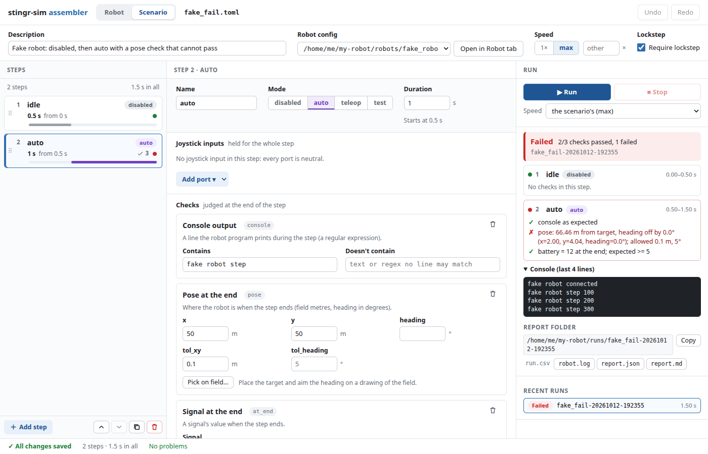

# The scenario editor

`scrimmage edit` also opens scenario files. The Scenario tab edits the steps, joystick inputs, checks and
screenshots of a scenario (`scenarios/*.toml`) with forms, runs it in the simulator and shows the report on the
page. It reads and writes the same TOML file you would edit by hand: comments and ordering stay, and every edit
is checked by the real scenario loader and validator before it is written.



Contents: [Starting it](#starting-it), [The page](#the-page), [Walkthrough](#walkthrough), [Pickers](#pickers),
[Running and reading reports](#running-and-reading-reports), [Stop](#stop), [Read-only cases and invalid files](#read-only-cases-and-invalid-files),
[Inputs](#inputs-constant-values-and-tracks), [Input tracks](#input-tracks), [Where reports go](#where-reports-go),
[Undo and outside edits](#undo-and-outside-edits).

## Starting it

```bash
scrimmage edit scenarios/kitbot_auto.toml                                   # edit an existing scenario
scrimmage edit my_test.toml --new-scenario --robot configs/kitbot.toml      # write a starter scenario first, then edit it
scrimmage edit my_test.toml --no-browser                                    # only print the URL
```

`scrimmage edit FILE` looks at the file: a top-level `config` key or `[[step]]` entries make it a scenario, anything
else a robot config (see [the assembler](assembler.md)). `--new-scenario` writes a starter (a 1 s disabled step and
a 5 s auto step) and needs `--robot`; it refuses to overwrite an existing file. `--port N` picks a fixed port and
`--no-browser` prints the link instead of opening it; the link carries a token, and the server listens on 127.0.0.1
only. Stop it with Ctrl+C.

A scenario opens on the **Scenario** tab; the **Robot** tab (the assembler) edits the robot that scenario uses.
The tabs only show when a scenario is open; a robot-only session shows just the robot.

## The page

- **Header:** the description, the robot config (a dropdown of the configs in `configs/` and next to the scenario,
  plus **Open in Robot tab**), the speed (`1x`, `max` or another number), **Require lockstep**, and the **Match**
  row: the scenario's `[match]` (Station, FMS attached, Match timer, Auto length, Teleop length). Each starts at
  "robot config's", which leaves that key to the config. See [match data](match.md).
- **Steps (left):** each step with its name, mode, duration and start time, a bar drawn to scale, icons for
  checks and screenshots, and a pass/fail dot from the latest run. **Add step** inserts after the selected step;
  the buttons below move, duplicate and delete it, and steps can be dragged to reorder.
- **Step editor (center):** name, mode (disabled, auto, teleop, test), duration and game data; joystick inputs;
  checks; screenshots and an optional contact sheet. An empty Game data box keeps what the step before left (the box
  shows it, such as `keeps "R"`), and **Clear it here** clears it for this step and the ones after.
- **Run (right):** Run, Stop, a speed override, live progress, the report and recent runs.

## Walkthrough

1. Open a scenario (or create one with `--new-scenario`). Pick the robot config in the header if it isn't the right one.
2. **Add step.** Choose its mode and duration. The start time of every later step updates.
3. **Joystick inputs:** choose **Add port**, then **+ axis**, **+ button** or **+ POV** and set the values: a slider
   and number for an axis (-1 to 1), toggles for buttons (1 is the first button), a compass for a POV (-1 is released).
4. **Add check** and pick a kind: pose, odometry error, signal at the end, signal throughout, must touch, never
   touch or console output. Each has a form with the validator's message beside any field it rejects.
5. **Run.** Read the report, fix a check, run again.

An edit that the loader or validator rejects is not written; the message appears at the field and the box
keeps what you typed so you can correct it.

## Pickers

- **Field picker (pose checks).** **Pick on field...** opens a top-down drawing of the robot's world with the robot
  at its start pose. Click to set x and y, drag to aim the heading, and set the tolerances (drawn as a circle and a
  wedge). Other pose checks in the step show as ghosts. Leave heading empty to check position only.
- **Signal picker (signal at the end / throughout).** A list of the robot's real signals: `battery`, `speed`,
  `motor.<name>.current` and `.command`, `joint.<name>.position` and `.velocity`. For anything else choose
  `hal:...` or `nt:/...` and type the rest. Then set `min`, `max`, `equals` or `approx` with a tolerance.
- **Contact picker (must touch / never touch).** A list of the geoms and bodies the robot's world can report
  contacts for. A world with nothing to touch (or one that doesn't load) disables those two checks.
- **Camera picker (screenshots).** A screenshot's view is `follow`, `top`, a free camera (position and look-at) or
  one of the model's own cameras (`camera:<name>`); it is taken at the start or end of the step or at a time. A
  contact sheet takes several frames across the step.

## Running and reading reports

**Run** plays the scenario as it is on the page, headless, like `scrimmage run`. While it runs the panel shows the step
(`2/3 auto`), the simulated time and the robot program's console lines as they arrive. Only one run goes at a time.

The report shows each step with every check's result and the runner's own message (for example
`pose: 66.46 m from target, heading off by 0.0°; allowed 0.1 m, 5°`), the console tail, screenshot thumbnails (click to enlarge), contact
sheets and the report folder path with links to `report.md`, `report.json` and the log. The step dots in the left
column follow the steps by name, so after a reorder or rename a dot only shows where the run still matches.
Recent runs of this session are listed under the report; click one to read it.

A run ends **Passed**, **Failed** (a check or an implicit check failed), **Error** (the robot program didn't start,
disconnected or crashed, or the scenario couldn't run; the runner's message and console tail say why) or **Stopped**.

Run uses a snapshot of the scenario taken when you press it, so edits made during a run affect the next run only.
The snapshot is saved in the run folder as `scenario.toml`; the report is titled with your scenario's own file name.

## Stop

**Stop** asks the run to end, also while the robot program is still starting. The robot program is shut down, the
run is marked **Stopped** and the partial report (everything judged so far) is shown. Run is enabled again
afterwards. If the run ended for another reason at the same moment (the robot program crashed, say), it shows as
**Error** with that reason instead. Closing the editor stops a run the same way, and no robot program outlives it.

## Read-only cases and invalid files

The Scenario tab is read-only (a banner says why, and you can still look around) when:

- **The robot has a problem.** The scenario's robot config is missing, has errors or doesn't load. The banner reads
  "fix the robot first" with the problem, and **Open in Robot tab** takes you there; fix it and the scenario becomes
  editable by itself. The same happens if the config is deleted while the page is open.
- **The scenario isn't valid TOML.** Fix the file in a text editor.

A scenario that is valid TOML but has errors (a bad mode, an unknown signal, a missing config) is not read-only,
and one rule governs it: **an invalid file still accepts edits that don't add errors**. While the file is valid, an
edit is written only if the result is valid. While it already has errors, an edit is written when it doesn't leave
more errors than the file has now, so you can fix errors one at a time even when fixing one reveals the next.
Every step's errors count (within one step the first problem shows, and fixing it may reveal the next), so an edit
that breaks another step is refused.
**Run waits until the file is valid**; the button is disabled and says how many errors to fix.

The Robot tab is read-only for hand-written MJCF robots (`[model] mjcf = ...`); the scenario for such a robot is
still fully editable.

## Inputs: constant values and tracks

A step's joystick `axes`, `buttons` and `povs` are constant for the whole step. To change an input partway through,
either split the step in two or give the step a track (below).

## Input tracks

A step can instead hold `inputs = "<file>.csv"`: a CSV of timed joystick values, relative to the scenario file. The
easiest way to get one is to record a drive in the [Drive tab](drive.md) and save it as a scenario; the format is
described in [drive.md](drive.md#input-tracks-the-csv-format). A step with `inputs` can't also have `axes`, `buttons`
or `povs`, and a bad or missing CSV is an error on that step with the line number.

The step editor shows such a step's track as a read-only plot (axes as lines, buttons and POV as lanes) with:

- **Trim:** *Keep from* and *to* (seconds). Trim writes the kept part to a **new** file next to the old one
  (`step1.trim1.csv`, then `.trim2.csv`, ...), points the step at it and sets the duration to the length kept. It never
  overwrites a file, so **Undo** brings the old track and duration straight back.
- **Choose file...:** point the step at another CSV.
- **Replace with constant inputs:** remove `inputs` from the step (the CSV stays on disk); then use the usual forms.

Run replays the track on robot-step boundaries. **Watch** (beside Run) shows a run in 3D; to drive instead, use
**Drive this robot** in the header.

## Where reports go

Each run writes a folder `runs/<scenario>-<timestamp>/` under the directory you started `scrimmage edit` in, with
`report.md`, `report.json`, `robot.log`, `run.csv` and any screenshots. The page shows the folder's path with a
Copy button and keeps the last 10 runs of the session in its list; the folders stay on disk.

## Undo and outside edits

**Undo** and **Redo** (Ctrl+Z, Ctrl+Shift+Z, when focus is not in a text box) step through the session's edits. If the file changes on disk while the
page is open, the page reloads it with a notice and the undo history starts again.
